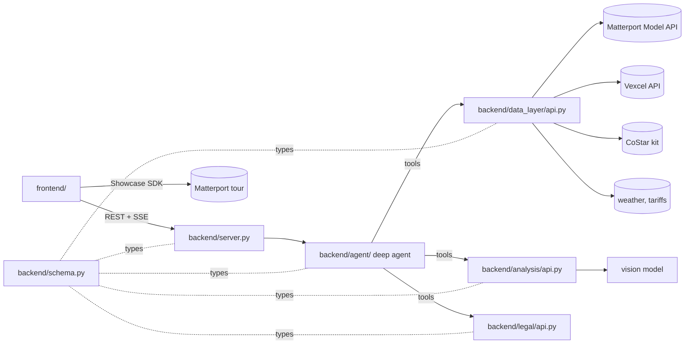

# Master spec

Status: draft v0.3.3, 2026-11-14. Owner: @yalexie1. Change by agreement on the board.

v0.2 folds in five corrections the Data lane verified live on 2026-11-14 (`data-integration.md` section 7): direct CoStar join keys, the Matterport georeference, measured wall openings, CoStar occupancy and market data, and the real layout of the CoStar kit.

v0.3 (contract 0.3.0) adds what the physics and legal specs needed, all additive: incentive eligibility and a rebate-after-install kind, real-rate and AIRR fields on the financial breakdown, the export regime on the tariff, a `published_default` source, a `no_cost_data` skip reason, the non-baseload CO2 figure, desk-score and layout detail, visible transmittance on windows, room polygons, and value uplift on the rooftop solar measure for homes.

v0.3.1 adds `CostarData.parent_ids`: one Matterport scan can be attached to several CoStar records, so the alternatives travel with the bundle.

v0.3.2 adds `VexcelDetection.mask_area_m2`: SAM 3 masks are nested fragments, so the area of a detection is the area of its own mask, never a sum of masks, a bounding box or a hull. `mask_wkt` stays `None` until a true polygon is derived from the mask.

v0.3.3 adds `"place"` to `FetchRecord.layer`, for the incorporated-place lookup that names the electric utility and decides whether a property lies in a C-PACE program area.

Companion files:

| File | What it holds | Main reader |
|---|---|---|
| `specs/workplan.md` | Who builds what, work packages, rules for parallel work | everyone, first |
| `specs/data-integration.md` | CoStar, Matterport, Vexcel and external data | Data lane |
| `specs/physics.md` | Index of the physics spec: `specs/physics/01-solar-pv.md`, `02-thermal-systems.md`, `03-daylight-comfort.md`, `04-economics-emissions-mv.md`. Every formula, with sources | Analysis lane |
| `specs/legal/california.md`, `specs/legal/texas.md` | What each state's law requires in each document, with citations | Agent lane |
| `specs/legal.md` | Document templates, clause library and the placeholder table. Owner: @Sri-SriPod (handed over on the board, 2026-11-14) | Agent lane |
| `specs/examples/` | Example payloads for every contract type | everyone |

Verification tags used in all spec files:

- **[V]** verified against a primary source on the date given
- **[P]** pending: needs the hackathon keys or a live check, owner named
- **[U]** unverified second-hand information, do not build on it without checking

---

## 1. Product

An energy consultant for a scanned building. The user picks a property and a budget. The system reads the building from the inside (Matterport), from above (Vexcel) and from its market record (CoStar), simulates its energy use with physics models, evaluates every retrofit that applies, and returns a plan ranked by money saved that fits the budget. The user can then draft the legal documents needed to carry the plan out.

Two flows, built to the same depth:

| | Home flow | Office flow |
|---|---|---|
| User | homeowner, landlord, tenant | building owner, investor, lender, tenant |
| Typical measures | attic and wall insulation, air sealing, windows, cool roof, heat pump, water heater, lighting, rooftop solar | lighting power and controls, rooftop units, economizer, cool roof, plug loads, rooftop solar, desk placement |
| No-cost measures | furniture and workspace placement for daylight, thermostat schedule | desk placement for daylight, glare and comfort, schedule setback |
| Financing view | cash only | cash, and C-PACE where eligible |
| Documents | retrofit contract, solar agreement, bid package, savings guarantee | the same plus the C-PACE package |

## 2. Tracks

| Track | What it asks | How this project answers | Tag |
|---|---|---|---|
| Sustainability (main) | environmental impact | measured kWh, dollars and CO2 saved per building, with sources | [U] |
| CoStar "Inside and Out" | at least two of the three data layers used together; agentic (reasons, plans, acts); something a CoStar customer would switch on Monday; spatial and visual understanding | all three layers feed one building model; the agent plans the audit, chooses what to fetch, asks only when needed, drafts documents; retrofit and C-PACE screening is an owner, investor and lender workflow | [V] 2026-11-13, track site config |
| LangChain | must be built as a `deepagents` agent | orchestrator deep agent with five subagents, section 8 | [U] |
| Amazon | practical AI that reasons, plans, acts, adapts | same agent; no AWS services used, so this entry rests on usefulness alone | [U] |

CoStar judging weights [V]: use of the data 30, agentic depth 30, customer usefulness 25, demo and polish 15.

## 3. Constraints from the data

1. **No scan upload.** The keys reach 14,944 existing Matterport models in the Houston and Los Angeles areas. "Input the scan" means search by address or name and pick a model. [V]
2. **What "commercial" means here.** The index marks 13,014 models commercial and 1,930 residential, but most commercial models are apartment units. Models that carry a numeric CoStar property id number 6,191; LoopNet suites (offices and shops) are about 210. The office flow finds its candidates by CoStar property type (`propertyType` 5, Office), not by the index segment. [V] counts from `models_index.csv`; [V] 2026-11-14 property-type enum from the kit's `schemas/enums.json`.
3. **A scan has geometry, not thermal properties.** It gives room polygons, room type, area, width, depth, height, a wall graph with wall thickness, the openings in each wall (type, width, height, sill elevation, position along the wall), a georeference (latitude, longitude and the rotation of the model frame to true north), panoramas, and floor plans. So the size, position and orientation of windows and doors are data. It does not give U-values, insulation, glazing performance (U-value, solar heat gain), HVAC equipment or electrical service size. Those are inferred, section 5. Doors and windows are never wall-edge types (`EdgeType` is only `wall` or `invisible`); they are openings on an edge, typed `divider`, `doorway`, `opening` or `window`. [V] 2026-11-14 for the opening and georeference fields and both enums, live and by schema introspection; window openings are populated on the golden house (sills 0.63 to 1.11 m above the floor, widths 0.51 to 2.69 m), and an opening's position along its wall is a fraction of the wall's length from 0 to 1, not metres (41 of 41 openings fit their wall read that way). Whether every model carries window openings is still [P] Data lane, hence the vision fallback.
4. **Exterior 3D exists for few models.** 232 models have an aerial Gaussian splat and drone photos (211 residential, 21 commercial). For the rest, the exterior comes from Vexcel footprints, roof attributes and obliques. [V]
5. **Unit versus building.** An apartment unit or office suite is part of a larger building. Roof and envelope measures belong to the building owner. The run request carries the user's role, and measures are filtered by it, section 6.2.
6. **Coverage.** Vexcel keys work only in Houston and Los Angeles. All sponsor data is licensed for the hackathon only and must not be committed. [V]
7. **The CoStar kit joins to models directly.** The kit is a 49 MB zip with two starter CSVs, eight JSONL datasets, and field documentation (`schemas/`, `models/`, `concepts/`). `commercial-properties.csv` (`PropertyId`, `MatterportModelId`) and `residential-listings.csv` (`ListingId`, `ResidentialListingId`, `MatterportModelId`) map each record to its Matterport model, so the join does not go through `models_index.csv`. The Model API has no geographic search, so property search runs on these CSVs. Besides property and listing records, the kit holds tenancies, tenant companies with employee counts, sale comparables and apartment asking rents, which feed occupancy (section 5.1) and value uplift (section 6.6). [V] 2026-11-14, `data-integration.md` section 2.

## 4. User flow

1. **Find.** Search by address, name or map. Result cards show segment, use type, city, and which layers are available.
2. **Set up.** Budget in dollars (hard upfront cash cap). Role: owner-occupier, landlord, or tenant. Optional: twelve months of utility bills.
3. **Watch the audit.** The agent's plan and progress stream beside the 3D tour: fetching layers, reading panoramas, building the model, simulating, pricing.
4. **Answer, only if asked.** At most three questions, each tied to one assumption whose range changes the result (section 5.3).
5. **Read the plan.** Ranked measures inside the budget, then the financeable list, each with its full financial breakdown and a range. Measures are pinned in the 3D tour; the roof view shows the panel layout.
6. **Adjust.** Edit any assumption or the budget; the plan re-runs.
7. **Draft documents.** Pick a document type, confirm the parties, review the draft with its unfilled blanks and statutory checklist, export.

## 5. Building model and unknowns

### 5.1 Assumption registry

Every input the physics needs that is not measured is an `Assumption`: a key, a low/expected/high value, a source, a confidence, and the evidence behind it. Sources, strongest first:

| Source | Meaning |
|---|---|
| `user` | the user stated it |
| `measured` | read directly from the scan (areas, heights, wall thickness, opening sizes and positions, orientation from the georeference) |
| `costar` | from the CoStar record (year built, building class, gross building area, tenancies and tenant employee counts) |
| `vexcel` | from Vexcel attributes (roof material, shape, condition, footprint, tree cover) |
| `vision` | a model read it from panoramas or aerial imagery |
| `published_default` | a published figure that is not specific to the building, such as a state average electricity price |
| `vintage_default` | lookup by construction era, climate zone and building type |

A stronger source replaces a weaker one for the same key. Vintage default tables and their sources are in `specs/physics/02-thermal-systems.md` section 8 (DEF entries).

What is data and what is an assumption:

- **Windows.** In homes, area, position and orientation come from the scan's wall openings and georeference (`measured`). Commercial scans carry almost no openings: in a sample of 12 office models the Data lane found no window opening at all, against 34 in 12 homes. So for offices, and for any model without window openings, windows come from the interior panoramas (`vision`, range about ±30 percent), and where vision finds none, from a window-to-wall ratio in the office default table applied to the footprint and storey count (`vintage_default`, wider still; `specs/physics/02-thermal-systems.md` DEF entries). Glazing performance, meaning U-value and solar heat gain coefficient, is always an assumption. Decided by the owner, 2026-11-14.
- **Office occupancy.** Where CoStar has tenancy records, the number of occupants, their industry and the tenancy period are data (`costar`) and drive plug loads, lighting schedules and ventilation. Homes, and offices with no tenant record, use the vintage defaults.
- **Year built and area.** CoStar has no single year-built field. Years are in `constructionEvents[]`; the model uses the construction-complete event and records which event it used. The envelope uses gross building area, never rentable area.

### 5.2 What vision reads

| Target | Imagery | Output |
|---|---|---|
| Windows: frame, single or double pane cues, shading; count and size only as a cross-check on the measured openings, or where a model has none | panoramas | glazing assumption; window surfaces only as the fallback |
| HVAC: wall units, registers, thermostat type, rooftop units | panoramas, ortho | system type and age band |
| Water heater: tank or tankless, fuel cues | panoramas | type |
| Lighting: fixture type and density | panoramas | lighting power density range |
| Wall material: drywall, plaster, masonry, panelling | panoramas | construction era cue, routing difficulty |
| Outlets: two-prong, three-prong, GFCI; main panel if visible | panoramas | wiring-age cue, service flag |
| Roof: roof outline and usable area, trees | Vexcel ortho and obliques via SAM 3, label `roof` | roof masks. Obstruction counts and existing solar come from Vexcel's precomputed `roof-objects` and `solar` attributes, not from SAM 3 |

Outlet type and wall material are cues, not proof. They move an assumption's range and confidence; they never set a hard fact. The items that decide solar installation are service panel capacity and roof structure, so those are reported as `likely_ok`, `likely_upgrade`, or `unknown`. A fourth value, `blocked`, is for a cue that rules a measure out on site rather than adding cost, for example a water heater in a closet too small for a heat pump unit (`dhw.space`, which blocks `DHW_HPWH`). Each `likely_upgrade` carries `added_cost_usd` as a range.

### 5.3 When the agent asks the user

The agent asks only when the range is too wide to act on:

1. Run the plan at expected values.
2. For each assumption, re-run at its low and at its high with all others at expected.
3. Ask if either holds:
   - the set of selected measures differs between low and high, or
   - for that one assumption, the plan's total annual savings satisfy `(high - low) / expected > ASK_WIDTH` (default 0.40, in `backend/config.py`), where high and low are the totals of its two runs.

   The test is applied per assumption, and the plan is re-selected in each run, so a run may pick different measures from the expected-value plan.
4. Ask about the one assumption with the largest swing. Offer concrete choices plus "I don't know". Re-run. Stop after `ASK_MAX` questions (default 3) or when neither condition holds.

"I don't know" keeps the range and the result is shown with it.

## 6. Analysis

### 6.1 Pipeline

| Stage | Lane | Input | Output |
|---|---|---|---|
| S1 Locate | Data | search text or `sid` | `PropertySummary` |
| S2 Ingest | Data | `sid` | `PropertyBundle` (all three layers, weather, tariffs) |
| S3 See | Analysis (vision) | `PropertyBundle` | observations with evidence |
| S4 Model | Analysis | bundle + observations | `BuildingModel` |
| S5 Baseline | Analysis (physics) | `BuildingModel` | `BaselineResult` |
| S6 Measures | Analysis | model + baseline | `MeasureResult[]` |
| S7 Plan | Analysis (finance) | measures + budget + role | `Plan` |
| S8 Explain | Agent | all results | narrative, tags, questions |
| S9 Draft | Agent (legal) | `Plan` + `DocumentRequest` | `DocumentDraft` |

Stages S2 to S7 are deterministic functions. The agent decides order, depth and fallbacks; it does not compute.

### 6.2 Measure library

IDs are stable and appear in the contract as `MeasureId`.

| ID | Measure | Home | Office | Who can do it | Physics modules |
|---|---|---|---|---|---|
| `ENV_ATTIC` | attic or roof insulation | x | x | owner | envelope, zone model |
| `ENV_WALL` | wall insulation | x | | owner | envelope, zone model |
| `ENV_AIRSEAL` | air sealing | x | x | owner, tenant with consent | infiltration |
| `WIN_REPLACE` | window replacement | x | x | owner | envelope, solar gain |
| `WIN_FILM` | solar control film | x | x | owner, tenant with consent | solar gain |
| `WIN_SHADE` | exterior or interior shading | x | x | all | solar gain |
| `ROOF_COOL` | cool roof coating or membrane | x | x | owner | envelope, sol-air |
| `HVAC_HP` | heat pump replacing AC and furnace | x | | owner | HVAC |
| `HVAC_RTU` | high-efficiency rooftop unit | | x | owner | HVAC |
| `HVAC_ECON` | economizer and controls | | x | owner | ventilation, HVAC |
| `HVAC_DUCT` | duct sealing | x | | owner | HVAC |
| `DHW_HPWH` | heat pump water heater | x | | owner | water heating |
| `LGT_LED` | LED retrofit | x | x | all | lighting, HVAC interaction |
| `LGT_CTRL` | occupancy and daylight controls | | x | owner, tenant | lighting, daylight |
| `PLUG_MGMT` | plug load management | | x | all | plug loads |
| `CTRL_TSTAT` | smart thermostat and setback | x | x | all | zone model |
| `PV_ROOF` | rooftop solar | x | x | owner | solar pipeline |
| `LAYOUT` | desk or furniture placement | x | x | all | daylight, glare, comfort |

A measure is skipped with a stated reason when the role cannot do it, when the model shows it is already done, or when a feasibility flag blocks it.

"Tenant with consent" means the assumption `lease.alteration_consent` is true (a user answer or a document); without it a tenant gets the measure as financeable with the owner's consent, not selected.

Conventions on `MeasureResult.params`, agreed on the board on 2026-11-14 between the measure packages (A16 to A22) and finance (A24): when `applicable` is false, `params["skip_reason"]` holds the machine-readable reason (`role`, `feasibility`, `already_done`, `not_supported`), set by the measure engine, and `not_applicable_reason` holds the sentence. The quantity finance prices is in `params` under the key its cost entry names (for example `floor_area_m2`, `roof_area_m2`, `glazing_area_m2`, `thermostats`); solar size comes from `MeasureResult.solar`. For `PV_ROOF`, `savings.electricity_kwh` is the full production; the netted, self-consumed and exported kWh are in `params`.

Limits the physics spec puts on this table (`specs/physics/02-thermal-systems.md`, sections 10 and 12):

- **`HVAC_RTU` and `HVAC_ECON`** are evaluated only when a packaged rooftop unit is confirmed, by Vexcel, by interior vision, or by the user. Otherwise they return not applicable. `HVAC_ECON` savings are net of the added latent load.
- **`HVAC_DUCT`** returns not applicable for now: no source for the distribution efficiency of leaky ducts could be opened. The baseline uses an upper-bound figure.
- **`ROOF_COOL`** uses the envelope, sol-air and zone modules. It is fully supported on low-slope roofs; on a home with a vented attic the result is an upper bound and carries a warning.
- **`HVAC_HP`** needs the proposed product's SEER2, HSPF2 and certified COP at 47 °F. **`DHW_HPWH`** assumes the heater sits outside the conditioned space.
- **`LGT_LED` in offices, `LGT_CTRL`, `PLUG_MGMT`, `ENV_AIRSEAL` and `CTRL_TSTAT`** each depend on one parameter that has no opened source yet (for example the lighting power after retrofit, or the setback depth). Until each has a citation it is carried as an assumption with a wide range and the measure's result is marked as resting on it.
- A vacant office suite, one with no current tenancy, is modelled with the `office_vacant` schedule.

### 6.3 Solar pipeline

1. **Locate the lot.** Latitude and longitude from the Matterport georeference, then Vexcel `property/extract` for the parcel polygon and structure footprints, then the CoStar record joined on the Matterport model id.
2. **Exterior geometry**, best available source first:
   1. aerial splat plus drone photos (232 models): sample the splat, fit roof planes;
   2. Vexcel footprint and roof shape class: build a parametric roof (flat, gable, hip) whose pitch is a range looked up by shape (`physics.md`). Vexcel's calculated roof height is not used to derive pitch: on the golden house it read below grade and changed between calls, so it is a hint that must pass a sanity check (`data-integration.md` section 4.3). This is the P0 path;
   3. footprint with a flat or assumed-pitch roof, widest range.
   The interior model is rotated to true north with the Matterport georeference (`data-integration.md` section 3.2); matching the floor outline to the Vexcel footprint is a cross-check, and the fallback when the georeference is missing. The aerial splat is in its own local frame and is registered to the footprint.
3. **Roof understanding.** Two sources, each used for what it measured well on the golden house (`data-integration.md` section 4.4):
   - **Obstructions and existing solar: Vexcel precomputed attributes first.** `roof-objects` counts (chimney, skylight, roof vent, AC unit) and `solar` are the primary source. SAM 3 missed the house's chimney, reported two skylights that are not there, and found one of five vents.
   - **Roof extent and usable area: SAM 3** through Vexcel `elements/detect` on the ortho and the newest obliques, label `roof` at a detection threshold near 0.3, keeping each detection's confidence. The label `roof plane` returns nothing, and the default threshold of 0.5 discards most real detections (confidences ran 0.31 to 0.70). SAM 3 returns roof fragments, not clean planes (13 on one small house), so the masks give area and tree overhang, not plane geometry. Each detection comes back as a map-coordinate bounding polygon plus a pixel mask (a PNG cropped to its pixel box); the Analysis lane turns masks into map polygons.
   - **Which building, and which extent: the floor plate decides.** The design roof is the Vexcel structure that contains the CoStar address point; where it and the structure at the Matterport georeference differ, the one whose footprint best matches the CoStar floor plate (`building_area_m2 / stories`) is used, and the georeference is the fallback when CoStar has no point (data-integration D16). On a tower standing on a podium, aerial captures can outline either the tower or tower plus podium, 1.9x apart at the old LA office, sometimes disagreeing about rooftop solar. **A11 and A14 design on the plate-matched structure (the tower).** The podium can belong to another owner, is often already used (the old LA office podium carries panels), and is not the building the scan and the CoStar record describe. The larger outline is reported, not designed on: D16 records it as `property/extract:extent` (layer `vexcel`, status `fallback`), and A19 turns that record into a `PV_ROOF` warning naming both areas (`extent_warnings`). Designing on the podium is not supported: `roof.usable_area_m2` is reported as an assumption, but an override of it does not yet resize the solar design. Decided by the lead on 2026-11-14.
   Usable area is the roof area minus an allowance per counted obstruction minus fire-code setbacks (setback values: `physics.md` or `legal.md`, cited). [V] 2026-11-14 request shape, labels and thresholds, live on the golden house; [P] the office lot.
4. **Tilt, azimuth, shading.** Per plane from the geometry: fitted planes where a splat exists; otherwise the parametric roof, with azimuth from the footprint's ridge direction and tilt as the pitch range for the roof shape. On the parametric roof the ridge direction is an assumption until an oblique image confirms it, and it is the largest single source of spread in the yield (about a fifth of annual energy on the golden house, against a few percent each for pitch and weather), so both ridge hypotheses are carried in the range. Shading: where exterior geometry exists (a splat), it is computed hour by hour by casting rays from panel points toward the sun against that geometry and the tree masks; on the parametric roof there is nothing to cast against, so shading is the default loss allowance in the PV model (`specs/physics/01-solar-pv.md`, SHD entries).
5. **Weather and production.** Typical-year irradiance and temperature for the site, then the PV model in `physics.md`.
6. **Layout.** Fill planes in order of annual yield per panel. Stop at the first of: roof area exhausted, budget reached, or annual production reaching the site's annual consumption.
7. **Indoor feasibility.** From section 5.2: outlet type and visible panel become an electrical flag with an added cost range for a likely service upgrade; wall material informs conduit routing cost. A flag of `unknown` raises a question under section 5.3 if it changes the plan.

### 6.4 Desk placement (office flow, `LAYOUT`)

1. Candidate desk positions on a 0.5 m grid inside rooms classed as work areas, at least 0.6 m from walls and clear of door swings. Office scans carry no room labels, so an unlabelled room counts as a work area; a room whose label names a bathroom, kitchen, closet, hall or stair does not. The door clearance is each door opening widened by the door width plus 0.6 m, kept clear under both readings of `Opening.relative_center` while the measuring vertex is unconfirmed (physics.md section 8).
2. For each candidate: daylight availability, glare risk for a seated viewer, and thermal comfort near glazing (`physics.md`, daylight, glare and comfort modules).
3. Score and choose the top N positions with a minimum spacing of 2.0 m (a design choice, not physics), N from the user, else from `Systems.occupants`, else from work area at 8 m² per desk. No desk is recommended where the radiant asymmetry from glazing reaches 10 K (physics 03, CMF).
4. Savings come from lighting energy displaced where daylight targets are met, and are reported like any other measure, with zero cost. They are claimed in full only where automatic daylight control exists or `LGT_CTRL` is in the plan. Without it, moving a desk saves energy only if people switch the lights off, so the saving is shown as a potential range from zero to the automatic-control figure; the midpoint used as expected has no published source and is flagged as an assumption (`specs/physics/03-daylight-comfort.md`, LCT-02).

The home flow uses the same engine for a home-office desk or reading spot.

### 6.5 Budget algorithm

Exactly as the team specified: rank by annual dollar savings; if the top measure does not fit, go to the next.

```
state     = baseline building
remaining = budget
plan      = []
pool      = applicable measures

repeat:
    for m in pool: evaluate m against state      # savings depend on what is already chosen
    order pool by annual_savings_usd.expected, highest first
    pick the first m with net_upfront_usd.expected <= remaining and annual_savings_usd.expected > 0
    if none: stop
    plan.append(m); remaining -= m.net_upfront_usd.expected
    state = state with m applied; pool.remove(m)

financeable = every measure left in pool with positive savings, evaluated against the final state
```

Rules:

- Zero-cost measures are always evaluated first, since they always fit.
- A measure whose `net_upfront_usd.high` exceeds `remaining` is still picked on its expected cost, and carries the warning "may exceed budget".
- Each skipped measure records why: over budget, role, feasibility, no positive savings, already done, or no cost data.
- A measure with no verified cost source is never priced from a guess. It is skipped with reason `no_cost_data` and the detail "no verified cost; needs a quote", unless the user enters a quote. Today that is `WIN_FILM`, `WIN_SHADE` and `PLUG_MGMT` (`specs/physics/04-economics-emissions-mv.md`, COST-01).
- Payback, NPV and SIR are shown but do not change the order.

### 6.6 Financial breakdown

Every recommended and financeable measure shows all of:

| Item | Notes |
|---|---|
| Installed cost, low/expected/high | with the cost source named |
| Incentives | each with type, amount, status (`verified`, `unverified`, `expired`) and citation |
| Net upfront cash | installed cost minus point-of-sale rebates only, meaning a discount on the invoice. Rebates claimed after installation (the LADWP programs pay by cheque) and tax benefits arrive later and do not reduce the cap |
| Annual savings, low/expected/high | kWh, gas, dollars |
| Annual operation and maintenance change | |
| Useful life | |
| Simple and discounted payback | |
| NPV, SIR, IRR | discount rate, analysis period and energy price escalation stated |
| CO2 avoided per year | |
| Financing scenarios | cash always; C-PACE where the property is eligible under its state's program (below) |

The plan as a whole also shows a **value uplift** where CoStar market data exists for the property: the estimated change in property value from the plan's annual savings, capitalised at a rate taken from comparable sales, as a low/expected/high range with the number of comparables used. It is reported beside the plan totals and is never added to savings or used in the ranking. Method and limits: `specs/physics/04-economics-emissions-mv.md`, VAL entries. For a home, the only uplift reported is for owned rooftop solar, on that measure.

C-PACE scenario fields: financed amount, rate, term (not longer than useful life), annual assessment, first-year net cash flow, the program's own savings test where it has one, eligibility notes, and plain statements that the assessment is a lien that runs with the property and of what the state requires from an existing mortgage holder. The rules differ by state and are set out below; statutory conditions, with citations, are in `specs/legal/texas.md` section 6 and `specs/legal/california.md` section 7.

Texas, verified 2026-11-14 (`specs/legal/texas.md` section 6):

- **Who is eligible.** Commercial, industrial and nonprofit property, and residential property with five or more units. Anything under five units is excluded, so a house or fourplex is cash only. The property must also lie in a PACE region: the City of Houston is one; Harris County outside the city is not on the program administrator's list.
- **Mortgage holder.** Consent is a statutory precondition whenever a mortgage lien exists, not a formality: written notice at least 30 days before the owner contract, and written consent.
- **Two savings ratios, kept apart.** The plan's SIR is the discounted life-cycle ratio from `physics.md`. The Texas program applies its own test, here called the program SIR: undiscounted projected savings over the assessment term divided by total project cost including financing costs, required to be at least 1. The statute itself has no such test; it requires an independent third-party review of projected savings. The C-PACE scenario reports the program SIR separately and marks the scenario ineligible when it is below 1.
- **Solar exports.** Texas has no statutory net metering. Surplus is sold to the customer's retail provider at an agreed value, so the model treats export value as an assumption whose low end is zero, and no document states a buyback rate as fact.

California, verified 2026-11-14 (`specs/legal/california.md` sections 4 and 7; rows marked M there were read on two mirrors of the code, not on the official site):

- **Availability.** No official page was found naming a programme or administrator that takes commercial PACE applications in the City or County of Los Angeles. Until one is confirmed, a Los Angeles C-PACE scenario is labelled hypothetical, and a draft leaves agency, programme and administrator blank.
- **What is statute and what is programme practice.** Mortgage-holder consent and a term no longer than useful life are programme practice for a new commercial assessment in California; neither was found as a statutory condition, so no document cites them as law. The one statutory numeric test found for commercial property is that annual property taxes plus assessments may not exceed 5 percent of the property's market value (Streets and Highways Code 5898.15). The scenario reports that ratio in its notes when a market value is known. California has no SIR test in statute.
- **Solar depends on the electric utility**, which is `Tariff.utility`. Inside the City of Los Angeles the utility is LADWP, a municipal utility: the state net metering statute and the CPUC solar consumer guide do not apply. In Southern California Edison territory the Net Billing Tariff applies and a residential contract needs the signed CPUC guide; a commercial net-billing PV project there is a prevailing-wage job (Public Utilities Code 769.2), which raises its installed cost. Export value is an assumption in both, taken from the utility's own tariff.

Federal incentives, confirmed 2026-11-14 against Public Law 119-21 and the amended code (`specs/physics/04-economics-emissions-mv.md`, INC-01 to INC-06) [V]:

| Provision | Status for work starting now |
|---|---|
| 25C, home efficiency credit | expired: property placed in service after 2025-12-31 does not qualify |
| 25D, residential clean energy credit | expired: expenditures after 2025-12-31 do not qualify |
| 179D, commercial building deduction | not available where construction begins after 2026-06-30 |
| 45L, new energy efficient home credit | not available for homes acquired after 2026-06-30 |
| 48, energy investment credit | not available for solar whose construction began after 2024 |
| 48E, clean electricity investment credit | the only one left for solar, and only for business-owned systems placed in service by 2027-12-31 that meet the prohibited-foreign-entity sourcing condition. Never for a homeowner |

So a home plan carries no federal tax credit. A business-owned solar measure may carry 48E with `eligibility` set to `needs_confirmation` and its conditions listed, because the tool cannot see the in-service date or the sourcing. Utility programs verified and usable: the LADWP Consumer Rebate, attic insulation, BOSS and CLIP programs, and the CenterPoint residential solar incentive; the rest of the registry is marked unverified and left out of the plan's arithmetic.

## 7. Architecture



- Language: Python 3.11+ backend, FastAPI server. Frontend stack is the frontend owner's choice.
- Lanes import only `backend/schema.py` and each other's `api.py`. See `workplan.md`.
- All physical quantities are SI inside the backend (m, m², W, kWh, K, kg). Gas is carried as kWh thermal. Money is USD. The frontend converts for display.

## 8. Agent

Built with LangChain `deepagents` on the Anthropic API.

| Agent | Job | Tools |
|---|---|---|
| `auditor` (orchestrator) | plans the audit, delegates, decides fallbacks, writes the narrative | `task`, filesystem, todo list, `ask_user` |
| `scout` | finds and ingests the property | `search_properties`, `get_property_bundle`, `get_asset` |
| `surveyor` | reads imagery, builds the building model | `observe_interior`, `detect_roof_elements`, `build_building_model`, `set_assumption` |
| `physicist` | runs simulations and measures | `run_baseline`, `evaluate_measure`, `design_pv`, `score_desk_positions` |
| `financier` | prices and plans | `price_measure`, `lookup_incentives`, `build_plan`, `cpace_scenario`, `sensitivity` |
| `counsel` | drafts documents | `list_templates`, `fill_template`, `check_document` |

Rules:

1. **The agent never does arithmetic.** Every number in the narrative comes from a tool result. A `check_narrative` step compares each number in the text against the structured results and rejects the text on a mismatch.
2. **Planning is visible.** The orchestrator keeps a todo list that is streamed to the frontend.
3. **Asking the user** is a tool (`ask_user`) that pauses the run and resumes with the answer. It is called only under section 5.3.
4. **Approval before drafting.** `fill_template` requires user approval of the parties and the measure list.
5. **Fallbacks are the agent's decisions**, and are logged: no splat, use the Vexcel roof; MatterPak locked, use the wall graph; no CoStar record, use the Vexcel building type and a wider vintage range; no georeference, register the floor outline to the Vexcel footprint; no window openings in the wall graph, use window sizes read by vision.
6. **Run artifacts** are written to the agent's file system under `/run/`: `bundle.json`, `model.json`, `baseline.json`, `measures.json`, `plan.json`, `report.md`.

Build notes, each to confirm against the installed versions [P] Agent lane:

- `create_deep_agent(model=..., tools=..., system_prompt=..., subagents=[...], interrupt_on=..., checkpointer=...)`. Signature read from the LangChain docs 2026-11-13 [V].
- Human-in-the-loop needs a checkpointer and a stable `thread_id`; resume with `Command(resume=...)` [V]. A custom tool can call `interrupt()` to ask a free-form question [V].
- A subagent given its own `tools` list gets only those plus the file tools; subagents cannot delegate further [U], field note tested on deepagents 0.7.38.
- The todo tool may need `TodoListMiddleware` added explicitly [U], same field note.
- Model ids live in `backend/config.py`: orchestrator `claude-opus-5-5`, subagents `claude-sonnet-5-5`, bulk image reading `claude-haiku-5-5`.

## 9. Shared contract

This block is the source for `backend/schema.py` (Pydantic v2). Version it with `SCHEMA_VERSION`. After the freeze, changes are additive only.

<!-- contract:start -->
```python
from __future__ import annotations
from typing import Literal, Optional, Union
from pydantic import BaseModel, Field, model_validator

SCHEMA_VERSION = "0.3.3"

# ---------- primitives ----------

class Ranged(BaseModel):
    """A quantity with uncertainty. low <= expected <= high.

    expected is the result at expected inputs; low and high are approximate
    10th and 90th percentiles (physics UNC-01), not hard bounds.
    """
    low: float
    expected: float
    high: float
    unit: str

    @model_validator(mode="after")
    def _ordered(self) -> "Ranged":
        if not (self.low <= self.expected <= self.high):
            raise ValueError("Ranged requires low <= expected <= high")
        return self

Source = Literal["user", "measured", "costar", "vexcel", "vision", "published_default", "vintage_default"]

class EvidenceRef(BaseModel):
    kind: Literal["pano", "ortho", "oblique", "matterport_field", "vexcel_attr",
                  "costar_field", "default_table", "user"]
    ref: str                      # pano id, attribute key, table id, ...
    note: Optional[str] = None

class Assumption(BaseModel):
    key: str                      # e.g. "wall.u_value", "hvac.cooling_cop"
    label: str
    value: Union[Ranged, str, bool]
    source: Source
    confidence: float = Field(ge=0, le=1)
    evidence: list[EvidenceRef] = []
    user_editable: bool = True

class Flag(BaseModel):
    key: str                      # e.g. "electrical.service"
    status: Literal["likely_ok", "likely_upgrade", "blocked", "unknown"]
    message: str
    added_cost_usd: Optional[Ranged] = None
    evidence: list[EvidenceRef] = []

# ---------- data lane ----------

Segment = Literal["residential", "commercial"]
UseType = Literal["single_family", "multifamily_unit", "office", "retail", "other", "unknown"]

class PropertySummary(BaseModel):
    sid: str                      # Matterport model id
    name: str
    segment: Segment
    use_type: UseType
    address: Optional[str] = None
    city: Optional[str] = None
    state: Optional[Literal["CA", "TX"]] = None
    lat: Optional[float] = None
    lon: Optional[float] = None
    costar_property_id: Optional[str] = None             # kit PropertyId (commercial)
    costar_listing_id: Optional[str] = None              # kit ListingId (residential)
    costar_residential_listing_id: Optional[str] = None  # groups the listings of one sale or rental
    has_splat: bool = False
    has_defurnished: bool = False
    pano_count: int = 0
    room_count: int = 0
    floor_count: int = 0

class Vertex(BaseModel):
    id: str
    x: float                      # metres, model frame
    y: float

class Opening(BaseModel):
    """A door or window in a wall edge, as measured by the scan."""
    id: str
    type: str                     # OpeningType: "divider", "doorway", "opening", "window"
    label: Optional[str] = None
    width_m: Optional[float] = None
    height_m: Optional[float] = None
    lower_elevation_m: Optional[float] = None   # bottom of the opening above the floor (sill height)
    relative_center: Optional[float] = Field(default=None, ge=0, le=1)   # NOT metres: centre as a fraction of
                                                # the edge length; centre in metres = relative_center * edge length.
                                                # Which vertex it is measured from is [P] Data lane

class WallEdge(BaseModel):
    id: str
    type: str                     # EdgeType: "wall" or "invisible"; doors and windows are openings
    thickness_m: Optional[float] = None
    vertex_ids: tuple[str, str]
    openings: list[Opening] = []

class Floor(BaseModel):
    id: str
    label: str
    vertices: list[Vertex]
    edges: list[WallEdge]

class Room(BaseModel):
    id: str
    floor_id: str
    label: Optional[str] = None   # Matterport classification
    label_confidence: Optional[float] = None
    area_m2: Optional[float] = None
    width_m: Optional[float] = None
    depth_m: Optional[float] = None
    height_m: Optional[float] = None
    boundary_edge_ids: list[str] = []
    polygon: list[tuple[float, float]] = []    # room outline in the model frame, metres, in order

class Pano(BaseModel):
    id: str
    label: Optional[str] = None
    x: float
    y: float
    z: float
    face_paths: list[str] = []    # six cached cube faces: up, four sides, down
    defurnished_face_paths: list[str] = []

class FloorplanAsset(BaseModel):
    format: str
    flags: list[str] = []
    path: str
    resolution_px_per_m: Optional[float] = None
    origin_x: Optional[float] = None
    origin_y: Optional[float] = None

class Quaternion(BaseModel):
    x: float
    y: float
    z: float
    w: float

class GeoReference(BaseModel):
    """Model.geocoordinates from the Model API. Places and rotates the model frame on the earth."""
    latitude: float
    longitude: float
    altitude_m: Optional[float] = None
    rotation: Quaternion                        # as returned; about z for a level model
    translation: Optional[tuple[float, float, float]] = None
    source: Optional[str] = None                # GeoCoordinateSource: "client", "processing", "unknown"

class MatterportData(BaseModel):
    georeference: Optional[GeoReference] = None
    floors: list[Floor]
    rooms: list[Room]
    panos: list[Pano]
    floorplans: list[FloorplanAsset] = []
    ai_summary: Optional[str] = None
    capture_notes: Optional[str] = None
    property_classifications: list[str] = []
    matterpak_available: bool = False
    mesh_path: Optional[str] = None
    point_cloud_path: Optional[str] = None
    splat_path: Optional[str] = None
    drone_photo_paths: list[str] = []
    defurnished_view_id: Optional[str] = None

class VexcelStructure(BaseModel):
    primary: bool = False
    footprint_wkt: Optional[str] = None
    footprint_area_m2: Optional[float] = None
    attributes: dict[str, Union[str, float, bool, None]] = {}   # flat dotted keys as returned

class VexcelDetection(BaseModel):
    label: str
    confidence: float
    image_id: str                               # e.g. "ortho-1", "oriented-1"
    bbox_wkt: str                               # map-coordinate polygon, as returned
    pixel_bbox: Optional[tuple[int, int, int, int]] = None   # x, y, w, h in the image
    mask_png_path: Optional[str] = None         # cached pixel mask, cropped to pixel_bbox
    mask_wkt: Optional[str] = None              # map polygon derived from the pixel mask
    mask_area_m2: Optional[float] = None        # ground area of the mask itself (pixel count x pixel ground area), not of its box or hull

class VexcelData(BaseModel):
    collection: Optional[str] = None
    parcel_wkt: Optional[str] = None
    attributes: dict[str, Union[str, float, bool, None]] = {}
    structures: list[VexcelStructure] = []
    ortho_path: Optional[str] = None
    oblique_paths: dict[str, str] = {}        # direction -> path
    detections: list[VexcelDetection] = []

class Tenancy(BaseModel):
    """One tenant in the building, from location-occupancy joined to company-detail."""
    tenant_name: Optional[str] = None
    industry: Optional[str] = None
    employees: Optional[int] = None
    area_m2: Optional[float] = None
    floor: Optional[str] = None
    move_in: Optional[str] = None              # ISO date
    move_out: Optional[str] = None             # ISO date; None = still in place

class OccupancyData(BaseModel):
    tenancies: list[Tenancy] = []
    employees_total: Optional[int] = None
    occupied_area_m2: Optional[float] = None

class MarketData(BaseModel):
    """Inputs to value uplift, from commercial-sale-comp and apartment-listing."""
    cap_rate: Optional[Ranged] = None                     # fraction per year, from comparable sales
    sale_price_usd_per_m2: Optional[Ranged] = None
    asking_rent_usd_per_m2_year: Optional[Ranged] = None
    comp_count: int = 0

class CostarData(BaseModel):
    kind: Literal["residential_listing", "commercial_property"]
    # join keys from the kit's starter CSVs; the join is on matterport_model_id
    matterport_model_id: str
    property_id: Optional[str] = None          # PropertyId, commercial
    listing_id: Optional[str] = None           # ListingId, residential
    residential_listing_id: Optional[str] = None
    parent_ids: list[str] = []                 # every PropertyId or ListingId this model is attached to; one
                                               # scan can belong to several (307 model ids do); the ids above are
                                               # the primary by the Data lane's documented rule
    record_id: str                             # `id` of the JSONL record
    raw: dict                                  # the record as found in the kit
    # normalised fields; names in the kit's models/ and schemas/ are authoritative
    property_type: Optional[str] = None        # enum name, e.g. "Office"
    property_type_code: Optional[int] = None   # propertyType enum value; Office = 5
    year_built: Optional[int] = None           # from constructionEvents[], ConstructionComplete preferred
    year_built_event: Optional[str] = None     # which construction event year_built came from
    year_renovated: Optional[int] = None
    building_class: Optional[str] = None       # "A", "B", "C", "F"
    building_area_m2: Optional[float] = None   # gross building area; use for the envelope
    rentable_area_m2: Optional[float] = None   # leasing only
    stories: Optional[int] = None
    owner_name: Optional[str] = None
    occupancy: Optional[OccupancyData] = None
    market: Optional[MarketData] = None

class ClimateSite(BaseModel):
    lat: float
    lon: float
    timezone: str
    climate_zone: Optional[str] = None
    weather_path: str                          # typical-year hourly file in the cache
    weather_source: str
    weather_time_convention: Optional[str] = None   # what an hourly stamp means: "hour_start", "hour_end", "hour_centre"
    pvgis_annual_kwh_per_kw: Optional[float] = None # cross-check only
    pvgis_sd_fraction: Optional[float] = None       # inter-annual standard deviation / annual yield

class Tariff(BaseModel):
    utility: str
    electricity_usd_per_kwh: float             # marginal price, with per-kWh riders and taxes
    gas_usd_per_kwh: Optional[float] = None    # per kWh of higher heating value; 1 therm = 29.3071 kWh
    export_usd_per_kwh: Optional[float] = None # None where no export price is mandated (Texas)
    export_regime: Optional[Literal["net_metering", "net_billing", "none"]] = None
    fixed_usd_per_month: float = 0.0
    source: str
    retrieved: str                             # ISO date

class FetchRecord(BaseModel):
    layer: Literal["matterport", "vexcel", "costar", "weather", "tariff", "place"]   # place: incorporated-place and program-area lookups
    what: str
    status: Literal["ok", "missing", "locked", "error", "fallback"]
    detail: Optional[str] = None

class PropertyBundle(BaseModel):
    schema_version: str = SCHEMA_VERSION
    summary: PropertySummary
    matterport: MatterportData
    vexcel: Optional[VexcelData] = None
    costar: Optional[CostarData] = None
    climate: ClimateSite
    tariff: Tariff
    provenance: list[FetchRecord] = []

# ---------- analysis lane ----------

class Surface(BaseModel):
    id: str
    zone_id: str
    kind: Literal["wall", "roof", "floor", "window", "door"]
    boundary: Literal["exterior", "ground", "adjacent_conditioned", "adjacent_unconditioned"]
    area_m2: float
    azimuth_deg: Optional[float] = None        # 0 = north, clockwise; None for horizontal
    tilt_deg: float                            # 0 = horizontal facing up, 90 = vertical
    u_value: Ranged                            # W/m2K
    shgc: Optional[Ranged] = None              # windows only
    visible_transmittance: Optional[Ranged] = None   # windows only; daylight needs it, shgc is not enough
    parent_surface_id: Optional[str] = None    # window -> wall
    source_edge_id: Optional[str] = None       # WallEdge this surface was built from
    source_opening_id: Optional[str] = None    # Opening this window or door was built from; None = from vision
    solar_absorptance: Optional[Ranged] = None # opaque exterior surfaces (physics ENV-05)
    emittance: Optional[float] = None
    exposed_perimeter_m: Optional[float] = None   # ground floors (physics ENV-04)

class Zone(BaseModel):
    id: str
    room_ids: list[str]
    use: str
    floor_area_m2: float
    volume_m3: float
    conditioned: bool = True
    mass_class: Literal["very_light", "light", "medium", "heavy", "very_heavy"] = "medium"   # physics ZON

class Systems(BaseModel):
    hvac_type: Literal["central_ac_furnace", "heat_pump", "rooftop_unit", "room_ac", "central_plant",
                       "none", "unknown"]
    heating_fuel: Literal["electricity", "gas", "none", "unknown"]
    cooling_cop: Ranged                        # seasonal, W/W
    heating_efficiency: Ranged                 # seasonal: COP for heat pumps, fraction for furnaces
    dhw_type: Literal["storage", "tankless", "heat_pump", "unknown"]
    dhw_fuel: Literal["electricity", "gas", "unknown"]
    dhw_efficiency: Ranged
    lighting_w_per_m2: Ranged
    plug_w_per_m2: Ranged
    infiltration_ach: Ranged                   # annual mean air changes per hour, a reported result
    occupancy_schedule: str                    # "home", "office" or "office_vacant" (physics DEF)
    occupants: Optional[Ranged] = None         # people; from CoStar tenancies when present
    # optional detail the thermal spec uses when known (specs/physics/02-thermal-systems.md section 12)
    infiltration_ach50: Optional[Ranged] = None             # homes: air changes at 50 Pa
    envelope_leakage_l_s_m2_75pa: Optional[Ranged] = None   # offices
    cooling_rating: Optional[Ranged] = None
    cooling_rating_metric: Optional[Literal["SEER", "SEER2", "EER", "EER2", "IEER"]] = None
    heating_rating: Optional[Ranged] = None
    heating_rating_metric: Optional[Literal["HSPF", "HSPF2", "AFUE", "COP"]] = None
    compressor_type: Literal["single", "two_stage", "variable", "unknown"] = "unknown"
    cooling_capacity_w: Optional[float] = None
    heating_cop_47f: Optional[float] = None
    hvac_install_year: Optional[int] = None
    distribution_efficiency: Optional[Ranged] = None
    duct_location: Literal["conditioned", "attic", "garage", "crawlspace", "none", "unknown"] = "unknown"
    outdoor_air_m3_s: Optional[Ranged] = None
    has_economizer: Optional[bool] = None
    economizer_limit_c: Optional[float] = None
    heating_setpoint_c: Optional[Ranged] = None
    cooling_setpoint_c: Optional[Ranged] = None
    heating_setback_c: Optional[float] = None
    cooling_setup_c: Optional[float] = None
    dhw_location: Literal["conditioned", "garage", "outdoor", "unknown"] = "unknown"

class RoofPlane(BaseModel):
    id: str
    polygon_wkt: str                           # map coordinates
    area_m2: float
    tilt_deg: Ranged
    azimuth_deg: float
    usable_area_m2: float
    obstructions: list[VexcelDetection] = []
    obstruction_counts: dict[str, int] = {}    # from Vexcel roof-objects, e.g. {"chimney": 1}; no positions
    ridge_confirmed: bool = False              # False = ridge direction assumed; both hypotheses are in the range
    eave_length_m: Optional[float] = None
    slope_length_m: Optional[float] = None
    geometry_source: Literal["splat", "vexcel_parametric", "assumed"]

class BuildingModel(BaseModel):
    schema_version: str = SCHEMA_VERSION
    sid: str
    bedrooms: Optional[int] = None             # homes; drives hot water and occupancy defaults
    north_offset_deg: Ranged                   # azimuth of the model frame's +y axis, degrees clockwise from true
                                               # north, so azimuth_true = azimuth_in_model + north_offset_deg
                                               # (physics ROOF-02). Derived from the georeference quaternion; which
                                               # way that quaternion rotates is [P]: confirm on the golden house
                                               # against the Vexcel footprint before trusting the sign
    north_source: Literal["georeference", "footprint_registration", "assumed"] = "georeference"
    zones: list[Zone]
    surfaces: list[Surface]
    systems: Systems
    roof_planes: list[RoofPlane] = []
    assumptions: list[Assumption]
    flags: list[Flag] = []

class EnergyUse(BaseModel):
    electricity_kwh: Ranged
    gas_kwh: Ranged
    cost_usd: Ranged
    co2_kg: Ranged                             # kg CO2-equivalent, first year: eGRID total-output rate for
                                               # electricity plus the EPA combustion factor for gas (physics EMI)
    co2_nonbaseload_kg: Optional[Ranged] = None   # the "up to" figure at the eGRID non-baseload rate

class BaselineResult(BaseModel):
    annual: EnergyUse
    end_use_kwh: dict[str, float]              # expected values; keys: heating, cooling, water_heating,
                                               # lighting, plug, appliances
    monthly_electricity_kwh: list[float]       # 12 values, expected
    monthly_gas_kwh: list[float]
    peak_cooling_w: float
    peak_heating_w: float
    calibrated_to_bills: bool = False
    heating_need_kwh: Optional[float] = None   # thermal need before system efficiency
    cooling_need_kwh: Optional[float] = None
    latent_cooling_kwh: float = 0.0
    hourly_path: Optional[str] = None          # cached hourly zone outputs, read by the desk-placement physics

MeasureId = Literal[
    "ENV_ATTIC", "ENV_WALL", "ENV_AIRSEAL", "WIN_REPLACE", "WIN_FILM", "WIN_SHADE",
    "ROOF_COOL", "HVAC_HP", "HVAC_RTU", "HVAC_ECON", "HVAC_DUCT", "DHW_HPWH",
    "LGT_LED", "LGT_CTRL", "PLUG_MGMT", "CTRL_TSTAT", "PV_ROOF", "LAYOUT"]

class Incentive(BaseModel):
    name: str
    kind: Literal["upfront_rebate", "rebate_after_install", "tax_credit", "tax_deduction",
                  "performance_payment"]         # only upfront_rebate reduces net_upfront_usd
    amount_usd: Ranged
    status: Literal["verified", "unverified", "expired"]          # of the program itself
    eligibility: Literal["confirmed", "needs_confirmation", "not_eligible"] = "confirmed"   # of this project
    conditions: list[str] = []                 # what must hold, e.g. "placed in service by 2027-12-31"
    citation: str

class FinancingScenario(BaseModel):
    kind: Literal["cash", "cpace"]
    eligible: bool
    financed_usd: float = 0.0
    rate: Optional[float] = None
    term_years: Optional[int] = None
    annual_payment_usd: float = 0.0
    net_cashflow_year1_usd: Ranged             # at base-date prices
    program_sir: Optional[float] = None        # the PACE program's own test (physics ECO-12b): undiscounted
                                               # savings over the term / total cost with financing costs;
                                               # Texas requires >= 1. Not the same as FinancialBreakdown.sir
    notes: list[str] = []

class FinancialBreakdown(BaseModel):
    installed_cost_usd: Ranged
    cost_source: str
    incentives: list[Incentive] = []
    net_upfront_usd: Ranged
    annual_savings_usd: Ranged
    annual_om_change_usd: float = 0.0
    useful_life_years: int
    simple_payback_years: Optional[Ranged] = None
    discounted_payback_years: Optional[float] = None
    npv_usd: Ranged
    npv_sensitivity_usd: Optional[float] = None   # NPV at the 7 percent sensitivity rate (physics ECO-05)
    sir: Optional[float] = None                # discounted savings-to-investment ratio (physics ECO-09)
    irr: Optional[float] = None                # conventional IRR; None when it is not unique
    airr: Optional[float] = None               # adjusted internal rate of return (physics ECO-10)
    discount_rate: float                       # real, not nominal
    electricity_escalation: float              # real, per year
    gas_escalation: float                      # real, per year
    analysis_period_years: int                 # min(useful life, 40)
    financing: list[FinancingScenario]

class Anchor(BaseModel):
    """Where to pin the measure in the 3D tour."""
    room_id: Optional[str] = None
    pano_id: Optional[str] = None
    x: Optional[float] = None
    y: Optional[float] = None
    z: Optional[float] = None
    label: str

class PanelPlacement(BaseModel):
    plane_id: str
    polygon_wkt: Optional[str] = None          # None when the layout is a count by area, not drawn positions
    annual_kwh: float
    shading_loss_fraction: float

class SolarDesign(BaseModel):
    system_kw_dc: float
    panel_count: int
    panels: list[PanelPlacement]
    annual_kwh: Ranged
    self_consumption_fraction: Optional[float] = None
    module_w: Optional[float] = None           # rated DC power per module
    dc_ac_ratio: Optional[float] = None
    inverter_kw_ac: Optional[float] = None
    losses_percent: Optional[float] = None     # total system losses applied (physics PV entries)
    degradation_rate: Optional[float] = None   # fraction per year
    electrical: Flag
    structural: Flag

class DeskScore(BaseModel):
    room_id: str
    x: float
    y: float
    daylight: float                            # daylight autonomy at 300 lux: fraction of occupied hours, 0 to 1
    glare_risk: float                          # fraction of occupied hours with glare, 0 to 1
    comfort_ppd: float                         # mean predicted percentage dissatisfied, percent, 5 to 100
    score: float                               # 0 to 1 (physics LCT-03)
    recommended: bool = False
    daylight_factor: Optional[float] = None    # percent
    view_azimuth_deg: Optional[float] = None   # recommended facing direction, clockwise from true north
    direct_sun_hours: Optional[float] = None   # occupied hours per year with the sun in view
    max_dt_pr_k: Optional[float] = None        # worst radiant temperature asymmetry, K
    warnings: list[str] = []

class LayoutResult(BaseModel):
    candidates: list[DeskScore]
    desks_requested: int
    window_source: Optional[Literal["measured", "vision"]] = None
    target_lux: Optional[float] = None
    setpoint_lux: Optional[float] = None
    control_type: Optional[str] = None         # lighting control assumed for the saving (physics LCT-01)
    score_weights: dict[str, float] = {}
    occupied_hours_per_year: Optional[float] = None
    lighting_kwh_saved: Optional[Ranged] = None
    warnings: list[str] = []                   # e.g. "window geometry read from panoramas"

class MeasureResult(BaseModel):
    measure_id: MeasureId
    title: str
    applicable: bool
    not_applicable_reason: Optional[str] = None
    description: str = ""
    params: dict = {}
    savings: Optional[EnergyUse] = None        # annual, against the state it was evaluated on
    finance: Optional[FinancialBreakdown] = None
    flags: list[Flag] = []
    anchors: list[Anchor] = []
    evidence: list[EvidenceRef] = []
    formula_ids: list[str] = []                # physics.md entries used
    solar: Optional[SolarDesign] = None
    layout: Optional[LayoutResult] = None
    value_uplift: Optional["ValueUplift"] = None   # homes with owned rooftop solar only (physics VAL-03)
    warnings: list[str] = []

class PlanItem(BaseModel):
    rank: int
    measure: MeasureResult
    cumulative_upfront_usd: float
    remaining_budget_usd: float

class SkippedItem(BaseModel):
    measure_id: MeasureId
    reason: Literal["over_budget", "role", "feasibility", "no_savings", "already_done", "no_cost_data"]
    detail: str

class ValueUplift(BaseModel):
    """Estimated change in property value from the plan's savings (physics VAL).

    Never added to savings, and never used in NPV, SIR, payback or ranking.
    Commercial and multifamily: capitalised savings, on Plan. Homes: owned rooftop
    solar only, on the PV_ROOF MeasureResult. There is no rent component yet.
    """
    value_usd: Ranged
    method: str                                # physics.md entry id
    cap_rate: Optional[Ranged] = None
    comp_count: int = 0
    notes: list[str] = []

class Plan(BaseModel):
    budget_usd: float
    selected: list[PlanItem]
    financeable: list[MeasureResult]
    skipped: list[SkippedItem]
    total_upfront_usd: Ranged
    total_annual_savings_usd: Ranged
    total_co2_kg: Ranged
    baseline_after: EnergyUse
    value_uplift: Optional[ValueUplift] = None

# ---------- agent and server ----------

Role = Literal["owner_occupier", "landlord", "tenant"]

class UtilityBills(BaseModel):
    electricity_kwh: list[float]               # 12 monthly values
    gas_kwh: Optional[list[float]] = None

class RunRequest(BaseModel):
    sid: str
    budget_usd: float = Field(ge=0)
    role: Role = "owner_occupier"
    bills: Optional[UtilityBills] = None
    overrides: dict[str, Union[float, str, bool]] = {}   # assumption key -> value
    desks_requested: Optional[int] = None

class Choice(BaseModel):
    label: str
    value: Union[float, str, bool, None]       # None = "I don't know"

class Question(BaseModel):
    id: str
    assumption_key: str
    prompt: str
    choices: list[Choice]
    impact_note: str

class RunEvent(BaseModel):
    type: Literal["stage_started", "stage_done", "todo", "tool_call", "fallback",
                  "question", "partial_result", "error", "done"]
    stage: Optional[str] = None
    message: str = ""
    payload: dict = {}

class RunResult(BaseModel):
    schema_version: str = SCHEMA_VERSION
    run_id: str
    status: Literal["running", "waiting_for_user", "done", "error"]
    request: RunRequest
    property: PropertySummary
    building_model: Optional[BuildingModel] = None
    baseline: Optional[BaselineResult] = None
    measures: list[MeasureResult] = []
    plan: Optional[Plan] = None
    questions: list[Question] = []
    narrative_md: str = ""
    warnings: list[str] = []

DocType = Literal["retrofit_contract_residential", "retrofit_contract_commercial",
                  "solar_installation_agreement", "bid_package_rfp",
                  "energy_savings_guarantee", "cpace_package"]

class DocumentRequest(BaseModel):
    run_id: str
    doc_type: DocType
    state: Literal["CA", "TX"]
    measure_ids: list[MeasureId]
    fields: dict[str, str] = {}                # user-supplied placeholders, by name

class StatutoryCheck(BaseModel):
    requirement_id: Optional[str] = None       # id in specs/legal/*.md, e.g. "CA-HIC-03"
    requirement: str
    citation: str
    satisfied: bool
    note: Optional[str] = None

class DocumentDraft(BaseModel):
    doc_id: str
    doc_type: DocType
    state: Literal["CA", "TX"]
    markdown: str
    unfilled_placeholders: list[str]
    statutory_checks: list[StatutoryCheck]
    disclaimer: str
```
<!-- contract:end -->

Placeholder names in `legal.md` are bound to these types in `legal.md`'s placeholder table (column "source").

## 10. Server API

| Method and path | Body | Returns |
|---|---|---|
| `GET /api/health` | | `{status, schema_version}` |
| `GET /api/properties/search?q=&segment=&use_type=&lat=&lon=&radius_m=&limit=` | | `PropertySummary[]` |
| `GET /api/properties/{sid}` | | `PropertySummary` |
| `POST /api/runs` | `RunRequest` | `{run_id}` |
| `GET /api/runs/{run_id}/events` | | server-sent events, each a `RunEvent` |
| `GET /api/runs/{run_id}` | | `RunResult` |
| `POST /api/runs/{run_id}/answers` | `{question_id, value}` | `{ok}` |
| `PATCH /api/runs/{run_id}` | `{budget_usd?, overrides?}` | `{ok}`, then new events |
| `POST /api/runs/{run_id}/documents` | `DocumentRequest` | `DocumentDraft` |
| `GET /api/runs/{run_id}/documents/{doc_id}` | | `DocumentDraft` |
| `GET /api/assets/{path}` | | cached image, for the roof view |

Runs are stored under `data/runs/{run_id}/`. Errors use `{error: {code, message}}` with standard HTTP status codes.

## 11. Frontend

| Screen | Shows | Data |
|---|---|---|
| Find | search box, map of the two cities, result cards | `PropertySummary[]` |
| Set up | budget, role, optional bills | `RunRequest` |
| Audit | 3D tour beside the agent's todo list and event stream; question cards when asked | `RunEvent`, `Question` |
| Plan | ranked measures inside budget, financeable list, skipped list with reasons, totals; each measure expands to its financial breakdown, ranges and evidence | `Plan` |
| Roof | Vexcel ortho with SAM 3 masks, roof planes and the panel layout | `SolarDesign`, `RoofPlane`, `VexcelData` |
| Layout | floor plan with desk score heat map and recommended positions | `LayoutResult`, `MatterportData` |
| Assumptions | every assumption with source, range and an edit control | `Assumption[]` |
| Documents | pick type, confirm parties, preview with blanks highlighted and the statutory checklist, export | `DocumentRequest`, `DocumentDraft` |

- The 3D tour is the Matterport Showcase embed, driven by the Showcase SDK with the SDK key: pin each selected measure at its `Anchor`, and jump the camera to the evidence panorama when a measure is clicked. Exact SDK calls and whether SDK sweep ids equal Model API pano ids: [P] Frontend lane.
- Ranges are always shown: expected value with the low to high span.
- Every number shown comes from the API. The frontend does no calculation beyond unit display.
- The frontend builds against `specs/examples/` until the server is live.

## 12. Configuration

Environment variables, in a git-ignored `.env` (names only; never commit values):

| Name | Used by |
|---|---|
| `MATTERPORT_API_KEY`, `MATTERPORT_API_TOKEN` | Data lane |
| `MATTERPORT_SDK_KEY` | Frontend |
| `VEXCEL_API_KEY` | Data lane |
| `COSTAR_KIT_URL` or `COSTAR_KIT_ZIP`, `COSTAR_ZIP_PASSWORD` | Data lane |
| `ANTHROPIC_API_KEY` | Agent lane, Analysis vision |
| weather and tariff API keys, if the chosen sources need them | Data lane |

`backend/config.py` (Analysis lane owns it) holds non-secret settings: model ids, `ASK_WIDTH`, `ASK_MAX`, discount rate, escalation rates, analysis period, default C-PACE rate and term, cache directory. Economic defaults and their sources come from `physics.md`.

## 13. Scope tiers

| Tier | Content |
|---|---|
| **P0**, must demo | three golden properties (the Los Angeles house with a splat, a Los Angeles office and a Houston office; ids in `data-integration.md` section 2.6) end to end on live data; all three layers in the bundle; building model with assumption registry; hourly baseline; measures `ENV_ATTIC`, `ENV_AIRSEAL`, `LGT_LED`, `HVAC_HP` or `HVAC_RTU`, `ROOF_COOL`, `PV_ROOF` on a parametric roof; budget plan with full financial breakdown; deep agent with subagents and the ask rule; plan screen and 3D tour with pins; one document (California retrofit contract) |
| **P1**, should | remaining measures; SAM 3 roof segmentation and drawn panel layout; ray-cast shading; desk placement; indoor electrical feasibility; C-PACE scenario; all five documents in both states |
| **P2**, if time | any property on demand; bill calibration; portfolio screening (rank many properties by retrofit return using Vexcel filters and CoStar records); document export to Word |

## 14. Acceptance criteria by lane

**Data.** `get_property_bundle(sid)` returns a valid `PropertyBundle` for both golden properties with all three layers present or an explicit `FetchRecord` explaining what is missing; a second call is served from cache; no secret or sponsor data is committed.

**Analysis.** Each function in `analysis/api.py` runs on `specs/examples/` inputs with no network; every physics function has a unit test against the worked example in `physics.md`; the plan for each golden property reproduces exactly on re-run; every `MeasureResult` lists its `formula_ids`.

**Agent and server.** A run on a golden property streams events, completes without manual steps, and its narrative passes `check_narrative`; the ask rule fires on a fixture built to have a wide range and stays silent on one built to be narrow; a document draft lists its unfilled placeholders and statutory checks.

**Frontend.** All screens render from `specs/examples/` with the server off; with the server on, a full run can be driven from Find to Documents without a page reload; ranges are visible on every figure.

## 15. Demo script

1. Search a Los Angeles house; open it; enter a budget.
2. The agent's plan appears; layers arrive; pins appear in the tour as findings are made.
3. One question is asked because one assumption is too wide; answer it; the range narrows on screen.
4. The plan: what fits the budget, what is financeable, what was skipped and why. Open the roof view with the panel layout.
5. Lower the budget; the plan re-ranks.
6. Switch to an office: desk layout heat map and the C-PACE view.
7. Draft the retrofit contract; show the filled terms, the blanks, and the statutory checklist.

## 16. Risks and open questions

| Item | Owner | Fallback |
|---|---|---|
| Georeference missing or wrong on a model (north alignment itself is no longer a risk: the Model API returns the rotation). Both golden models report source `processing`, meaning derived by Matterport, not set by a person | Data + Analysis | cross-check against the Vexcel footprint; if they disagree or the field is absent, register to the footprint and widen `north_offset_deg` |
| Commercial scans carry almost no window openings (none in 12 sampled offices) | Data + Analysis | decided: vision from panoramas, then a window-to-wall ratio default; office daylight and desk placement carry the wider range |
| The first golden office (PropertyId 354635) was an industrial warehouse in CoStar | resolved | replaced by two offices: 234088 in Houston and, in Los Angeles, 246899, itself replaced by Culver Connect (PropertyId 27120, model `ZSPaQbkGcJJ`) once D16 showed its bundle modelled the wrong building (`data-integration.md` 2.6, 4.5a; #253); `specs/examples/office/` and `office_houston/` |
| MatterPak locked for most models | Data | wall graph and room heights are enough for the thermal model |
| CoStar kit download link expires 2026-11-15 03:30 UTC | Data | the verified mirror the Data lane holds (git-ignored); get the zip from @vigjay, do not re-download |
| The kit's `index.md` mentions a separate zip for connecting to Matterport models, which nobody has | team, via `/ask-costar` | the starter CSVs already give the join |
| True offices are a small share of "commercial" | Data | select by CoStar `propertyType` 5 |
| Vexcel counts no rooftop AC unit on most buildings, including a class A tower (a detection limit, not proof of absence) | Analysis | `HVAC_RTU` and `HVAC_ECON` are evaluated where a unit is counted or confirmed by vision or the user; the Houston golden office has two |
| SAM 3 on roofs returns fragments and unreliable obstruction labels (measured on the golden house) | Analysis | already the design: precomputed roof attributes for obstructions, pitch by roof shape for tilt, SAM 3 for area only; fitted planes only where a splat exists |
| Whether sponsor imagery may be sent to an external model provider | team, via `/ask-costar` | SAM 3 through Vexcel needs no external call; panorama reading does |
| Federal and utility incentives in force | Analysis (finance) | compute without them, mark `unverified` |
| Legal drafts are not legal advice | Agent | disclaimer on every draft; blanks instead of guesses |
| Submission deadline not confirmed | Frontend | checkpoints in `workplan.md` are relative to it |
