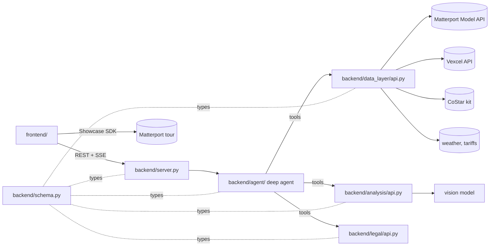

# Master spec

Status: draft v0.1, 2026-11-13. Owner: @yalexie1. Change by agreement on the board.

Companion files:

| File | What it holds | Main reader |
|---|---|---|
| `specs/workplan.md` | Who builds what, work packages, rules for parallel work | everyone, first |
| `specs/data-integration.md` | CoStar, Matterport, Vexcel and external data | Data lane |
| `specs/physics.md` | Every formula, with sources | Analysis lane |
| `specs/legal.md` | Contract templates and statutory terms | Agent lane |
| `specs/examples/` | Example payloads for every contract type | everyone |

Verification tags used in all spec files:

- **[V]** verified against a primary source on the date given
- **[P]** pending: needs the hackathon keys or a live check, owner named
- **[U]** unverified second-hand information, do not build on it without checking

---

## 1. Product

An energy consultant for a scanned building. The user picks a property and a budget. The system reads the building from the inside (Matterport), from above (Vexcel) and from its market record (CoStar), simulates its energy use with physics models, evaluates every retrofit that applies, and returns a plan ranked by money saved that fits the budget. The user can then draft the legal documents needed to carry the plan out.

Two flows, built to the same depth:

| | Home flow | Office flow |
|---|---|---|
| User | homeowner, landlord, tenant | building owner, investor, lender, tenant |
| Typical measures | attic and wall insulation, air sealing, windows, cool roof, heat pump, water heater, lighting, rooftop solar | lighting power and controls, rooftop units, economizer, cool roof, plug loads, rooftop solar, desk placement |
| No-cost measures | furniture and workspace placement for daylight, thermostat schedule | desk placement for daylight, glare and comfort, schedule setback |
| Financing view | cash only | cash and C-PACE |
| Documents | retrofit contract, solar agreement, bid package, savings guarantee | the same plus the C-PACE package |

## 2. Tracks

| Track | What it asks | How this project answers | Tag |
|---|---|---|---|
| Sustainability (main) | environmental impact | measured kWh, dollars and CO2 saved per building, with sources | [U] |
| CoStar "Inside and Out" | at least two of the three data layers used together; agentic (reasons, plans, acts); something a CoStar customer would switch on Monday; spatial and visual understanding | all three layers feed one building model; the agent plans the audit, chooses what to fetch, asks only when needed, drafts documents; retrofit and C-PACE screening is an owner, investor and lender workflow | [V] 2026-11-13, track site config |
| LangChain | must be built as a `deepagents` agent | orchestrator deep agent with five subagents, section 8 | [U] |
| Amazon | practical AI that reasons, plans, acts, adapts | same agent; no AWS services used, so this entry rests on usefulness alone | [U] |

CoStar judging weights [V]: use of the data 30, agentic depth 30, customer usefulness 25, demo and polish 15.

## 3. Constraints from the data

1. **No scan upload.** The keys reach 14,944 existing Matterport models in the Houston and Los Angeles areas. "Input the scan" means search by address or name and pick a model. [V]
2. **What "commercial" means here.** The index marks 13,014 models commercial and 1,930 residential, but most commercial models are apartment units. Models that carry a numeric CoStar property id number 6,191; LoopNet suites (offices and shops) are about 210. The office flow finds its candidates by CoStar property type, not by the index segment. [V] counts from `models_index.csv`; property-type field [P] Data lane.
3. **A scan has geometry, not thermal properties.** It gives room polygons, room type, area, width, depth, height, a wall graph with wall thickness, panoramas, and floor plans. It does not give U-values, insulation, window type, HVAC equipment or electrical service size. Those are inferred, section 5.
4. **Exterior 3D exists for few models.** 232 models have an aerial Gaussian splat and drone photos (211 residential, 21 commercial). For the rest, the exterior comes from Vexcel footprints, roof attributes and obliques. [V]
5. **Unit versus building.** An apartment unit or office suite is part of a larger building. Roof and envelope measures belong to the building owner. The run request carries the user's role, and measures are filtered by it, section 6.2.
6. **Coverage.** Vexcel keys work only in Houston and Los Angeles. All sponsor data is licensed for the hackathon only and must not be committed. [V]

## 4. User flow

1. **Find.** Search by address, name or map. Result cards show segment, use type, city, and which layers are available.
2. **Set up.** Budget in dollars (hard upfront cash cap). Role: owner-occupier, landlord, or tenant. Optional: twelve months of utility bills.
3. **Watch the audit.** The agent's plan and progress stream beside the 3D tour: fetching layers, reading panoramas, building the model, simulating, pricing.
4. **Answer, only if asked.** At most three questions, each tied to one assumption whose range changes the result (section 5.3).
5. **Read the plan.** Ranked measures inside the budget, then the financeable list, each with its full financial breakdown and a range. Measures are pinned in the 3D tour; the roof view shows the panel layout.
6. **Adjust.** Edit any assumption or the budget; the plan re-runs.
7. **Draft documents.** Pick a document type, confirm the parties, review the draft with its unfilled blanks and statutory checklist, export.

## 5. Building model and unknowns

### 5.1 Assumption registry

Every input the physics needs that is not measured is an `Assumption`: a key, a low/expected/high value, a source, a confidence, and the evidence behind it. Sources, strongest first:

| Source | Meaning |
|---|---|
| `user` | the user stated it |
| `measured` | read directly from scan geometry (areas, heights, wall thickness) |
| `costar` | from the CoStar record (year built, building class, size) |
| `vexcel` | from Vexcel attributes (roof material, shape, condition, footprint, tree cover) |
| `vision` | a model read it from panoramas or aerial imagery |
| `vintage_default` | lookup by construction era, climate zone and building type |

A stronger source replaces a weaker one for the same key. Vintage default tables and their sources are defined in `physics.md`.

### 5.2 What vision reads

| Target | Imagery | Output |
|---|---|---|
| Windows: count, size, frame, single or double pane cues, shading | panoramas | window surfaces per wall, glazing assumption |
| HVAC: wall units, registers, thermostat type, rooftop units | panoramas, ortho | system type and age band |
| Water heater: tank or tankless, fuel cues | panoramas | type |
| Lighting: fixture type and density | panoramas | lighting power density range |
| Wall material: drywall, plaster, masonry, panelling | panoramas | construction era cue, routing difficulty |
| Outlets: two-prong, three-prong, GFCI; main panel if visible | panoramas | wiring-age cue, service flag |
| Roof: planes, obstructions, existing solar, trees | Vexcel ortho and obliques via SAM 3 | roof polygons |

Outlet type and wall material are cues, not proof. They move an assumption's range and confidence; they never set a hard fact. The items that decide solar installation are service panel capacity and roof structure, so those are reported as `likely_ok`, `likely_upgrade`, or `unknown`.

### 5.3 When the agent asks the user

The agent asks only when the range is too wide to act on:

1. Run the plan at expected values.
2. For each assumption, re-run at its low and at its high with all others at expected.
3. Ask if either holds:
   - the set of selected measures differs between low and high, or
   - the plan's total annual savings satisfy `(high - low) / expected > ASK_WIDTH` (default 0.40, in `backend/config.py`).
4. Ask about the one assumption with the largest swing. Offer concrete choices plus "I don't know". Re-run. Stop after `ASK_MAX` questions (default 3) or when neither condition holds.

"I don't know" keeps the range and the result is shown with it.

## 6. Analysis

### 6.1 Pipeline

| Stage | Lane | Input | Output |
|---|---|---|---|
| S1 Locate | Data | search text or `sid` | `PropertySummary` |
| S2 Ingest | Data | `sid` | `PropertyBundle` (all three layers, weather, tariffs) |
| S3 See | Analysis (vision) | `PropertyBundle` | observations with evidence |
| S4 Model | Analysis | bundle + observations | `BuildingModel` |
| S5 Baseline | Analysis (physics) | `BuildingModel` | `BaselineResult` |
| S6 Measures | Analysis | model + baseline | `MeasureResult[]` |
| S7 Plan | Analysis (finance) | measures + budget + role | `Plan` |
| S8 Explain | Agent | all results | narrative, tags, questions |
| S9 Draft | Agent (legal) | `Plan` + `DocumentRequest` | `DocumentDraft` |

Stages S2 to S7 are deterministic functions. The agent decides order, depth and fallbacks; it does not compute.

### 6.2 Measure library

IDs are stable and appear in the contract as `MeasureId`.

| ID | Measure | Home | Office | Who can do it | Physics modules |
|---|---|---|---|---|---|
| `ENV_ATTIC` | attic or roof insulation | x | x | owner | envelope, zone model |
| `ENV_WALL` | wall insulation | x | | owner | envelope, zone model |
| `ENV_AIRSEAL` | air sealing | x | x | owner, tenant with consent | infiltration |
| `WIN_REPLACE` | window replacement | x | x | owner | envelope, solar gain |
| `WIN_FILM` | solar control film | x | x | owner, tenant with consent | solar gain |
| `WIN_SHADE` | exterior or interior shading | x | x | all | solar gain |
| `ROOF_COOL` | cool roof coating or membrane | x | x | owner | envelope, sol-air |
| `HVAC_HP` | heat pump replacing AC and furnace | x | | owner | HVAC |
| `HVAC_RTU` | high-efficiency rooftop unit | | x | owner | HVAC |
| `HVAC_ECON` | economizer and controls | | x | owner | ventilation, HVAC |
| `HVAC_DUCT` | duct sealing | x | | owner | HVAC |
| `DHW_HPWH` | heat pump water heater | x | | owner | water heating |
| `LGT_LED` | LED retrofit | x | x | all | lighting, HVAC interaction |
| `LGT_CTRL` | occupancy and daylight controls | | x | owner, tenant | lighting, daylight |
| `PLUG_MGMT` | plug load management | | x | all | plug loads |
| `CTRL_TSTAT` | smart thermostat and setback | x | x | all | zone model |
| `PV_ROOF` | rooftop solar | x | x | owner | solar pipeline |
| `LAYOUT` | desk or furniture placement | x | x | all | daylight, glare, comfort |

A measure is skipped with a stated reason when the role cannot do it, when the model shows it is already done, or when a feasibility flag blocks it.

### 6.3 Solar pipeline

1. **Locate the lot.** Matterport lat/lon, then Vexcel `property/extract` for the parcel polygon and structure footprints, then the CoStar record for the same property.
2. **Exterior geometry**, best available source first:
   1. aerial splat plus drone photos (232 models): sample the splat, fit roof planes;
   2. Vexcel footprint, roof shape class and calculated roof height: build a parametric roof (flat, gable, hip) with a pitch range by shape;
   3. footprint with a flat or assumed-pitch roof, widest range.
   The geometry is registered to true north (`data-integration.md` section 6).
3. **Roof understanding with SAM 3.** Vexcel `elements/detect` runs SAM 3 on the ortho and available obliques. Labels: roof plane, vent, chimney, skylight, rooftop HVAC unit, solar panel, tree. Masks come back as map-coordinate polygons. Usable area is each plane minus obstructions minus fire-code setbacks (setback values: `physics.md` or `legal.md`, cited). [V] endpoint and model name from the Vexcel tutorial, 2026-11-13; label quality on roofs [P] Analysis lane.
4. **Tilt, azimuth, shading.** Per plane from the geometry. Shading is computed hour by hour by casting rays from panel points toward the sun against the exterior geometry and tree masks.
5. **Weather and production.** Typical-year irradiance and temperature for the site, then the PV model in `physics.md`.
6. **Layout.** Fill planes in order of annual yield per panel. Stop at the first of: roof area exhausted, budget reached, or annual production reaching the site's annual consumption.
7. **Indoor feasibility.** From section 5.2: outlet type and visible panel become an electrical flag with an added cost range for a likely service upgrade; wall material informs conduit routing cost. A flag of `unknown` raises a question under section 5.3 if it changes the plan.

### 6.4 Desk placement (office flow, `LAYOUT`)

1. Candidate desk positions on a 0.5 m grid inside rooms classed as work areas, at least 0.6 m from walls and clear of door swings.
2. For each candidate: daylight availability, glare risk for a seated viewer, and thermal comfort near glazing (`physics.md`, daylight, glare and comfort modules).
3. Score and choose the top N positions with a minimum spacing, N from the user or from area per person.
4. Savings come from lighting energy displaced where daylight targets are met, and are reported like any other measure, with zero cost.

The home flow uses the same engine for a home-office desk or reading spot.

### 6.5 Budget algorithm

Exactly as the team specified: rank by annual dollar savings; if the top measure does not fit, go to the next.

```
state     = baseline building
remaining = budget
plan      = []
pool      = applicable measures

repeat:
    for m in pool: evaluate m against state      # savings depend on what is already chosen
    order pool by annual_savings_usd.expected, highest first
    pick the first m with net_upfront_usd.expected <= remaining and annual_savings_usd.expected > 0
    if none: stop
    plan.append(m); remaining -= m.net_upfront_usd.expected
    state = state with m applied; pool.remove(m)

financeable = every measure left in pool with positive savings, evaluated against the final state
```

Rules:

- Zero-cost measures are always evaluated first, since they always fit.
- A measure whose `net_upfront_usd.high` exceeds `remaining` is still picked on its expected cost, and carries the warning "may exceed budget".
- Each skipped measure records why: over budget, role, feasibility, or no positive savings.
- Payback, NPV and SIR are shown but do not change the order.

### 6.6 Financial breakdown

Every recommended and financeable measure shows all of:

| Item | Notes |
|---|---|
| Installed cost, low/expected/high | with the cost source named |
| Incentives | each with type, amount, status (`verified`, `unverified`, `expired`) and citation |
| Net upfront cash | installed cost minus point-of-sale rebates only; tax benefits arrive later and do not reduce the cap |
| Annual savings, low/expected/high | kWh, gas, dollars |
| Annual operation and maintenance change | |
| Useful life | |
| Simple and discounted payback | |
| NPV, SIR, IRR | discount rate, analysis period and energy price escalation stated |
| CO2 avoided per year | |
| Financing scenarios | cash always; C-PACE for commercial properties |

C-PACE scenario fields: financed amount, rate, term (not longer than useful life), annual assessment, first-year net cash flow, eligibility notes, and plain statements that the assessment is a lien that runs with the property and that an existing mortgage holder's consent is normally required. Statutory conditions are in `legal.md`.

Federal incentive status to confirm before use, from secondary sources read 2026-11-13 [U]: the residential credits under sections 25C and 25D ended for 2025; the section 179D commercial deduction ends for construction beginning after June 30, 2026; the section 48E credit for solar is cut off for facilities that begin construction after July 4, 2026 unless placed in service by the end of 2027. Until the finance package confirms these against primary sources, the registry marks federal incentives `unverified` and the plan is computed without them.

## 7. Architecture



- Language: Python 3.11+ backend, FastAPI server. Frontend stack is the frontend owner's choice.
- Lanes import only `backend/schema.py` and each other's `api.py`. See `workplan.md`.
- All physical quantities are SI inside the backend (m, m², W, kWh, K, kg). Gas is carried as kWh thermal. Money is USD. The frontend converts for display.

## 8. Agent

Built with LangChain `deepagents` on the Anthropic API.

| Agent | Job | Tools |
|---|---|---|
| `auditor` (orchestrator) | plans the audit, delegates, decides fallbacks, writes the narrative | `task`, filesystem, todo list, `ask_user` |
| `scout` | finds and ingests the property | `search_properties`, `get_property_bundle`, `get_asset` |
| `surveyor` | reads imagery, builds the building model | `observe_interior`, `detect_roof_elements`, `build_building_model`, `set_assumption` |
| `physicist` | runs simulations and measures | `run_baseline`, `evaluate_measure`, `design_pv`, `score_desk_positions` |
| `financier` | prices and plans | `price_measure`, `lookup_incentives`, `build_plan`, `cpace_scenario`, `sensitivity` |
| `counsel` | drafts documents | `list_templates`, `fill_template`, `check_document` |

Rules:

1. **The agent never does arithmetic.** Every number in the narrative comes from a tool result. A `check_narrative` step compares each number in the text against the structured results and rejects the text on a mismatch.
2. **Planning is visible.** The orchestrator keeps a todo list that is streamed to the frontend.
3. **Asking the user** is a tool (`ask_user`) that pauses the run and resumes with the answer. It is called only under section 5.3.
4. **Approval before drafting.** `fill_template` requires user approval of the parties and the measure list.
5. **Fallbacks are the agent's decisions**, and are logged: no splat, use the Vexcel roof; MatterPak locked, use the wall graph; no CoStar record, use the Vexcel building type and a wider vintage range.
6. **Run artifacts** are written to the agent's file system under `/run/`: `bundle.json`, `model.json`, `baseline.json`, `measures.json`, `plan.json`, `report.md`.

Build notes, each to confirm against the installed versions [P] Agent lane:

- `create_deep_agent(model=..., tools=..., system_prompt=..., subagents=[...], interrupt_on=..., checkpointer=...)`. Signature read from the LangChain docs 2026-11-13 [V].
- Human-in-the-loop needs a checkpointer and a stable `thread_id`; resume with `Command(resume=...)` [V]. A custom tool can call `interrupt()` to ask a free-form question [V].
- A subagent given its own `tools` list gets only those plus the file tools; subagents cannot delegate further [U], field note tested on deepagents 0.7.38.
- The todo tool may need `TodoListMiddleware` added explicitly [U], same field note.
- Model ids live in `backend/config.py`: orchestrator `claude-opus-5-5`, subagents `claude-sonnet-5-5`, bulk image reading `claude-haiku-5-5`.

## 9. Shared contract

This block is the source for `backend/schema.py` (Pydantic v2). Version it with `SCHEMA_VERSION`. After the freeze, changes are additive only.

<!-- contract:start -->
```python
from __future__ import annotations
from typing import Literal, Optional, Union
from pydantic import BaseModel, Field

SCHEMA_VERSION = "0.1.0"

# ---------- primitives ----------

class Ranged(BaseModel):
    """A quantity with uncertainty. low <= expected <= high."""
    low: float
    expected: float
    high: float
    unit: str

Source = Literal["user", "measured", "costar", "vexcel", "vision", "vintage_default"]

class EvidenceRef(BaseModel):
    kind: Literal["pano", "ortho", "oblique", "matterport_field", "vexcel_attr",
                  "costar_field", "default_table", "user"]
    ref: str                      # pano id, attribute key, table id, ...
    note: Optional[str] = None

class Assumption(BaseModel):
    key: str                      # e.g. "wall.u_value", "hvac.cooling_cop"
    label: str
    value: Union[Ranged, str, bool]
    source: Source
    confidence: float = Field(ge=0, le=1)
    evidence: list[EvidenceRef] = []
    user_editable: bool = True

class Flag(BaseModel):
    key: str                      # e.g. "electrical.service"
    status: Literal["likely_ok", "likely_upgrade", "blocked", "unknown"]
    message: str
    added_cost_usd: Optional[Ranged] = None
    evidence: list[EvidenceRef] = []

# ---------- data lane ----------

Segment = Literal["residential", "commercial"]
UseType = Literal["single_family", "multifamily_unit", "office", "retail", "other", "unknown"]

class PropertySummary(BaseModel):
    sid: str                      # Matterport model id
    name: str
    segment: Segment
    use_type: UseType
    address: Optional[str] = None
    city: Optional[str] = None
    state: Optional[Literal["CA", "TX"]] = None
    lat: Optional[float] = None
    lon: Optional[float] = None
    costar_property_id: Optional[str] = None
    homes_listing_id: Optional[str] = None
    has_splat: bool = False
    has_defurnished: bool = False
    pano_count: int = 0
    room_count: int = 0
    floor_count: int = 0

class Vertex(BaseModel):
    id: str
    x: float                      # metres, model frame
    y: float

class WallEdge(BaseModel):
    id: str
    type: str                     # as returned by the Model API
    thickness_m: Optional[float] = None
    vertex_ids: tuple[str, str]

class Floor(BaseModel):
    id: str
    label: str
    vertices: list[Vertex]
    edges: list[WallEdge]

class Room(BaseModel):
    id: str
    floor_id: str
    label: Optional[str] = None   # Matterport classification
    label_confidence: Optional[float] = None
    area_m2: Optional[float] = None
    width_m: Optional[float] = None
    depth_m: Optional[float] = None
    height_m: Optional[float] = None
    boundary_edge_ids: list[str] = []

class Pano(BaseModel):
    id: str
    label: Optional[str] = None
    x: float
    y: float
    z: float
    face_paths: list[str] = []    # six cached cube faces: up, four sides, down
    defurnished_face_paths: list[str] = []

class FloorplanAsset(BaseModel):
    format: str
    flags: list[str] = []
    path: str
    resolution_px_per_m: Optional[float] = None
    origin_x: Optional[float] = None
    origin_y: Optional[float] = None

class MatterportData(BaseModel):
    floors: list[Floor]
    rooms: list[Room]
    panos: list[Pano]
    floorplans: list[FloorplanAsset] = []
    ai_summary: Optional[str] = None
    capture_notes: Optional[str] = None
    property_classifications: list[str] = []
    matterpak_available: bool = False
    mesh_path: Optional[str] = None
    point_cloud_path: Optional[str] = None
    splat_path: Optional[str] = None
    drone_photo_paths: list[str] = []
    defurnished_view_id: Optional[str] = None

class VexcelStructure(BaseModel):
    primary: bool = False
    footprint_wkt: Optional[str] = None
    footprint_area_m2: Optional[float] = None
    attributes: dict[str, Union[str, float, bool, None]] = {}   # flat dotted keys as returned

class VexcelDetection(BaseModel):
    label: str
    confidence: float
    image_id: str
    bbox_wkt: str
    mask_wkt: Optional[str] = None

class VexcelData(BaseModel):
    collection: Optional[str] = None
    parcel_wkt: Optional[str] = None
    attributes: dict[str, Union[str, float, bool, None]] = {}
    structures: list[VexcelStructure] = []
    ortho_path: Optional[str] = None
    oblique_paths: dict[str, str] = {}        # direction -> path
    detections: list[VexcelDetection] = []

class CostarData(BaseModel):
    kind: Literal["residential_listing", "commercial_property"]
    record_id: str
    raw: dict                                  # the record as found in the kit
    # normalised fields, all optional until the kit columns are confirmed
    property_type: Optional[str] = None
    year_built: Optional[int] = None
    year_renovated: Optional[int] = None
    building_class: Optional[str] = None
    building_area_m2: Optional[float] = None
    stories: Optional[int] = None
    owner_name: Optional[str] = None

class ClimateSite(BaseModel):
    lat: float
    lon: float
    timezone: str
    climate_zone: Optional[str] = None
    weather_path: str                          # typical-year hourly file in the cache
    weather_source: str

class Tariff(BaseModel):
    utility: str
    electricity_usd_per_kwh: float
    gas_usd_per_kwh: Optional[float] = None
    export_usd_per_kwh: Optional[float] = None
    fixed_usd_per_month: float = 0.0
    source: str
    retrieved: str                             # ISO date

class FetchRecord(BaseModel):
    layer: Literal["matterport", "vexcel", "costar", "weather", "tariff"]
    what: str
    status: Literal["ok", "missing", "locked", "error", "fallback"]
    detail: Optional[str] = None

class PropertyBundle(BaseModel):
    schema_version: str = SCHEMA_VERSION
    summary: PropertySummary
    matterport: MatterportData
    vexcel: Optional[VexcelData] = None
    costar: Optional[CostarData] = None
    climate: ClimateSite
    tariff: Tariff
    provenance: list[FetchRecord] = []

# ---------- analysis lane ----------

class Surface(BaseModel):
    id: str
    zone_id: str
    kind: Literal["wall", "roof", "floor", "window", "door"]
    boundary: Literal["exterior", "ground", "adjacent_conditioned", "adjacent_unconditioned"]
    area_m2: float
    azimuth_deg: Optional[float] = None        # 0 = north, clockwise; None for horizontal
    tilt_deg: float                            # 0 = horizontal facing up, 90 = vertical
    u_value: Ranged                            # W/m2K
    shgc: Optional[Ranged] = None              # windows only
    parent_surface_id: Optional[str] = None    # window -> wall

class Zone(BaseModel):
    id: str
    room_ids: list[str]
    use: str
    floor_area_m2: float
    volume_m3: float
    conditioned: bool = True

class Systems(BaseModel):
    hvac_type: str
    heating_fuel: Literal["electricity", "gas", "none", "unknown"]
    cooling_cop: Ranged
    heating_efficiency: Ranged                 # COP for heat pumps, fraction for furnaces
    dhw_type: str
    dhw_fuel: Literal["electricity", "gas", "unknown"]
    dhw_efficiency: Ranged
    lighting_w_per_m2: Ranged
    plug_w_per_m2: Ranged
    infiltration_ach: Ranged
    occupancy_schedule: str                    # key into the schedule table

class RoofPlane(BaseModel):
    id: str
    polygon_wkt: str                           # map coordinates
    area_m2: float
    tilt_deg: Ranged
    azimuth_deg: float
    usable_area_m2: float
    obstructions: list[VexcelDetection] = []
    geometry_source: Literal["splat", "vexcel_parametric", "assumed"]

class BuildingModel(BaseModel):
    schema_version: str = SCHEMA_VERSION
    sid: str
    north_offset_deg: Ranged                   # rotation from model frame +y to true north
    zones: list[Zone]
    surfaces: list[Surface]
    systems: Systems
    roof_planes: list[RoofPlane] = []
    assumptions: list[Assumption]
    flags: list[Flag] = []

class EnergyUse(BaseModel):
    electricity_kwh: Ranged
    gas_kwh: Ranged
    cost_usd: Ranged
    co2_kg: Ranged

class BaselineResult(BaseModel):
    annual: EnergyUse
    end_use_kwh: dict[str, float]              # expected values by end use
    monthly_electricity_kwh: list[float]       # 12 values, expected
    monthly_gas_kwh: list[float]
    peak_cooling_w: float
    peak_heating_w: float
    calibrated_to_bills: bool = False

MeasureId = Literal[
    "ENV_ATTIC", "ENV_WALL", "ENV_AIRSEAL", "WIN_REPLACE", "WIN_FILM", "WIN_SHADE",
    "ROOF_COOL", "HVAC_HP", "HVAC_RTU", "HVAC_ECON", "HVAC_DUCT", "DHW_HPWH",
    "LGT_LED", "LGT_CTRL", "PLUG_MGMT", "CTRL_TSTAT", "PV_ROOF", "LAYOUT"]

class Incentive(BaseModel):
    name: str
    kind: Literal["upfront_rebate", "tax_credit", "tax_deduction", "performance_payment"]
    amount_usd: Ranged
    status: Literal["verified", "unverified", "expired"]
    citation: str

class FinancingScenario(BaseModel):
    kind: Literal["cash", "cpace"]
    eligible: bool
    financed_usd: float = 0.0
    rate: Optional[float] = None
    term_years: Optional[int] = None
    annual_payment_usd: float = 0.0
    net_cashflow_year1_usd: Ranged
    notes: list[str] = []

class FinancialBreakdown(BaseModel):
    installed_cost_usd: Ranged
    cost_source: str
    incentives: list[Incentive] = []
    net_upfront_usd: Ranged
    annual_savings_usd: Ranged
    annual_om_change_usd: float = 0.0
    useful_life_years: int
    simple_payback_years: Optional[Ranged] = None
    discounted_payback_years: Optional[float] = None
    npv_usd: Ranged
    sir: Optional[float] = None
    irr: Optional[float] = None
    discount_rate: float
    electricity_escalation: float
    gas_escalation: float
    analysis_period_years: int
    financing: list[FinancingScenario]

class Anchor(BaseModel):
    """Where to pin the measure in the 3D tour."""
    room_id: Optional[str] = None
    pano_id: Optional[str] = None
    x: Optional[float] = None
    y: Optional[float] = None
    z: Optional[float] = None
    label: str

class PanelPlacement(BaseModel):
    plane_id: str
    polygon_wkt: str
    annual_kwh: float
    shading_loss_fraction: float

class SolarDesign(BaseModel):
    system_kw_dc: float
    panel_count: int
    panels: list[PanelPlacement]
    annual_kwh: Ranged
    self_consumption_fraction: Optional[float] = None
    electrical: Flag
    structural: Flag

class DeskScore(BaseModel):
    room_id: str
    x: float
    y: float
    daylight: float                            # metric defined in physics.md
    glare_risk: float
    comfort_ppd: float
    score: float
    recommended: bool = False

class LayoutResult(BaseModel):
    candidates: list[DeskScore]
    desks_requested: int

class MeasureResult(BaseModel):
    measure_id: MeasureId
    title: str
    applicable: bool
    not_applicable_reason: Optional[str] = None
    description: str = ""
    params: dict = {}
    savings: Optional[EnergyUse] = None        # annual, against the state it was evaluated on
    finance: Optional[FinancialBreakdown] = None
    flags: list[Flag] = []
    anchors: list[Anchor] = []
    evidence: list[EvidenceRef] = []
    formula_ids: list[str] = []                # physics.md entries used
    solar: Optional[SolarDesign] = None
    layout: Optional[LayoutResult] = None
    warnings: list[str] = []

class PlanItem(BaseModel):
    rank: int
    measure: MeasureResult
    cumulative_upfront_usd: float
    remaining_budget_usd: float

class SkippedItem(BaseModel):
    measure_id: MeasureId
    reason: Literal["over_budget", "role", "feasibility", "no_savings", "already_done"]
    detail: str

class Plan(BaseModel):
    budget_usd: float
    selected: list[PlanItem]
    financeable: list[MeasureResult]
    skipped: list[SkippedItem]
    total_upfront_usd: Ranged
    total_annual_savings_usd: Ranged
    total_co2_kg: Ranged
    baseline_after: EnergyUse

# ---------- agent and server ----------

Role = Literal["owner_occupier", "landlord", "tenant"]

class UtilityBills(BaseModel):
    electricity_kwh: list[float]               # 12 monthly values
    gas_kwh: Optional[list[float]] = None

class RunRequest(BaseModel):
    sid: str
    budget_usd: float = Field(ge=0)
    role: Role = "owner_occupier"
    bills: Optional[UtilityBills] = None
    overrides: dict[str, Union[float, str, bool]] = {}   # assumption key -> value
    desks_requested: Optional[int] = None

class Choice(BaseModel):
    label: str
    value: Union[float, str, bool, None]       # None = "I don't know"

class Question(BaseModel):
    id: str
    assumption_key: str
    prompt: str
    choices: list[Choice]
    impact_note: str

class RunEvent(BaseModel):
    type: Literal["stage_started", "stage_done", "todo", "tool_call", "fallback",
                  "question", "partial_result", "error", "done"]
    stage: Optional[str] = None
    message: str = ""
    payload: dict = {}

class RunResult(BaseModel):
    schema_version: str = SCHEMA_VERSION
    run_id: str
    status: Literal["running", "waiting_for_user", "done", "error"]
    request: RunRequest
    property: PropertySummary
    building_model: Optional[BuildingModel] = None
    baseline: Optional[BaselineResult] = None
    measures: list[MeasureResult] = []
    plan: Optional[Plan] = None
    questions: list[Question] = []
    narrative_md: str = ""
    warnings: list[str] = []

DocType = Literal["retrofit_contract_residential", "retrofit_contract_commercial",
                  "solar_installation_agreement", "bid_package_rfp",
                  "energy_savings_guarantee", "cpace_package"]

class DocumentRequest(BaseModel):
    run_id: str
    doc_type: DocType
    state: Literal["CA", "TX"]
    measure_ids: list[MeasureId]
    fields: dict[str, str] = {}                # user-supplied placeholders, by name

class StatutoryCheck(BaseModel):
    requirement: str
    citation: str
    satisfied: bool
    note: Optional[str] = None

class DocumentDraft(BaseModel):
    doc_id: str
    doc_type: DocType
    state: Literal["CA", "TX"]
    markdown: str
    unfilled_placeholders: list[str]
    statutory_checks: list[StatutoryCheck]
    disclaimer: str
```
<!-- contract:end -->

Placeholder names in `legal.md` are bound to these types in `legal.md`'s placeholder table (column "source").

## 10. Server API

| Method and path | Body | Returns |
|---|---|---|
| `GET /api/health` | | `{status, schema_version}` |
| `GET /api/properties/search?q=&segment=&use_type=&lat=&lon=&radius_m=&limit=` | | `PropertySummary[]` |
| `GET /api/properties/{sid}` | | `PropertySummary` |
| `POST /api/runs` | `RunRequest` | `{run_id}` |
| `GET /api/runs/{run_id}/events` | | server-sent events, each a `RunEvent` |
| `GET /api/runs/{run_id}` | | `RunResult` |
| `POST /api/runs/{run_id}/answers` | `{question_id, value}` | `{ok}` |
| `PATCH /api/runs/{run_id}` | `{budget_usd?, overrides?}` | `{ok}`, then new events |
| `POST /api/runs/{run_id}/documents` | `DocumentRequest` | `DocumentDraft` |
| `GET /api/runs/{run_id}/documents/{doc_id}` | | `DocumentDraft` |
| `GET /api/assets/{path}` | | cached image, for the roof view |

Runs are stored under `data/runs/{run_id}/`. Errors use `{error: {code, message}}` with standard HTTP status codes.

## 11. Frontend

| Screen | Shows | Data |
|---|---|---|
| Find | search box, map of the two cities, result cards | `PropertySummary[]` |
| Set up | budget, role, optional bills | `RunRequest` |
| Audit | 3D tour beside the agent's todo list and event stream; question cards when asked | `RunEvent`, `Question` |
| Plan | ranked measures inside budget, financeable list, skipped list with reasons, totals; each measure expands to its financial breakdown, ranges and evidence | `Plan` |
| Roof | Vexcel ortho with SAM 3 masks, roof planes and the panel layout | `SolarDesign`, `RoofPlane`, `VexcelData` |
| Layout | floor plan with desk score heat map and recommended positions | `LayoutResult`, `MatterportData` |
| Assumptions | every assumption with source, range and an edit control | `Assumption[]` |
| Documents | pick type, confirm parties, preview with blanks highlighted and the statutory checklist, export | `DocumentRequest`, `DocumentDraft` |

- The 3D tour is the Matterport Showcase embed, driven by the Showcase SDK with the SDK key: pin each selected measure at its `Anchor`, and jump the camera to the evidence panorama when a measure is clicked. Exact SDK calls and whether SDK sweep ids equal Model API pano ids: [P] Frontend lane.
- Ranges are always shown: expected value with the low to high span.
- Every number shown comes from the API. The frontend does no calculation beyond unit display.
- The frontend builds against `specs/examples/` until the server is live.

## 12. Configuration

Environment variables, in a git-ignored `.env` (names only; never commit values):

| Name | Used by |
|---|---|
| `MATTERPORT_API_KEY`, `MATTERPORT_API_TOKEN` | Data lane |
| `MATTERPORT_SDK_KEY` | Frontend |
| `VEXCEL_API_KEY` | Data lane |
| `COSTAR_KIT_URL` or `COSTAR_KIT_ZIP`, `COSTAR_ZIP_PASSWORD` | Data lane |
| `ANTHROPIC_API_KEY` | Agent lane, Analysis vision |
| weather and tariff API keys, if the chosen sources need them | Data lane |

`backend/config.py` (Analysis lane owns it) holds non-secret settings: model ids, `ASK_WIDTH`, `ASK_MAX`, discount rate, escalation rates, analysis period, default C-PACE rate and term, cache directory. Economic defaults and their sources come from `physics.md`.

## 13. Scope tiers

| Tier | Content |
|---|---|
| **P0**, must demo | two golden properties (one house with a splat, one office) end to end on live data; all three layers in the bundle; building model with assumption registry; hourly baseline; measures `ENV_ATTIC`, `ENV_AIRSEAL`, `LGT_LED`, `HVAC_HP` or `HVAC_RTU`, `ROOF_COOL`, `PV_ROOF` on a parametric roof; budget plan with full financial breakdown; deep agent with subagents and the ask rule; plan screen and 3D tour with pins; one document (California retrofit contract) |
| **P1**, should | remaining measures; SAM 3 roof segmentation and drawn panel layout; ray-cast shading; desk placement; indoor electrical feasibility; C-PACE scenario; all five documents in both states |
| **P2**, if time | any property on demand; bill calibration; portfolio screening (rank many properties by retrofit return using Vexcel filters and CoStar records); document export to Word |

## 14. Acceptance criteria by lane

**Data.** `get_property_bundle(sid)` returns a valid `PropertyBundle` for both golden properties with all three layers present or an explicit `FetchRecord` explaining what is missing; a second call is served from cache; no secret or sponsor data is committed.

**Analysis.** Each function in `analysis/api.py` runs on `specs/examples/` inputs with no network; every physics function has a unit test against the worked example in `physics.md`; the plan for each golden property reproduces exactly on re-run; every `MeasureResult` lists its `formula_ids`.

**Agent and server.** A run on a golden property streams events, completes without manual steps, and its narrative passes `check_narrative`; the ask rule fires on a fixture built to have a wide range and stays silent on one built to be narrow; a document draft lists its unfilled placeholders and statutory checks.

**Frontend.** All screens render from `specs/examples/` with the server off; with the server on, a full run can be driven from Find to Documents without a page reload; ranges are visible on every figure.

## 15. Demo script

1. Search a Los Angeles house; open it; enter a budget.
2. The agent's plan appears; layers arrive; pins appear in the tour as findings are made.
3. One question is asked because one assumption is too wide; answer it; the range narrows on screen.
4. The plan: what fits the budget, what is financeable, what was skipped and why. Open the roof view with the panel layout.
5. Lower the budget; the plan re-ranks.
6. Switch to an office: desk layout heat map and the C-PACE view.
7. Draft the retrofit contract; show the filled terms, the blanks, and the statutory checklist.

## 16. Risks and open questions

| Item | Owner | Fallback |
|---|---|---|
| Model frame may not be north-aligned | Data + Analysis | register floor outline to Vexcel footprint; if ambiguous, carry a wide `north_offset_deg` and ask |
| MatterPak locked for most models | Data | wall graph and room heights are enough for the thermal model |
| CoStar kit columns unknown until opened | Data | normalised fields stay optional; vintage defaults widen |
| True offices are a small share of "commercial" | Data | select by CoStar property type and LoopNet ids |
| SAM 3 label quality on roofs | Analysis | Vexcel precomputed roof attributes and roof-object counts |
| Whether sponsor imagery may be sent to an external model provider | team, via `/ask-costar` | SAM 3 through Vexcel needs no external call; panorama reading does |
| Federal and utility incentives in force | Analysis (finance) | compute without them, mark `unverified` |
| Legal drafts are not legal advice | Agent | disclaimer on every draft; blanks instead of guesses |
| Submission deadline not confirmed | Frontend | checkpoints in `workplan.md` are relative to it |
